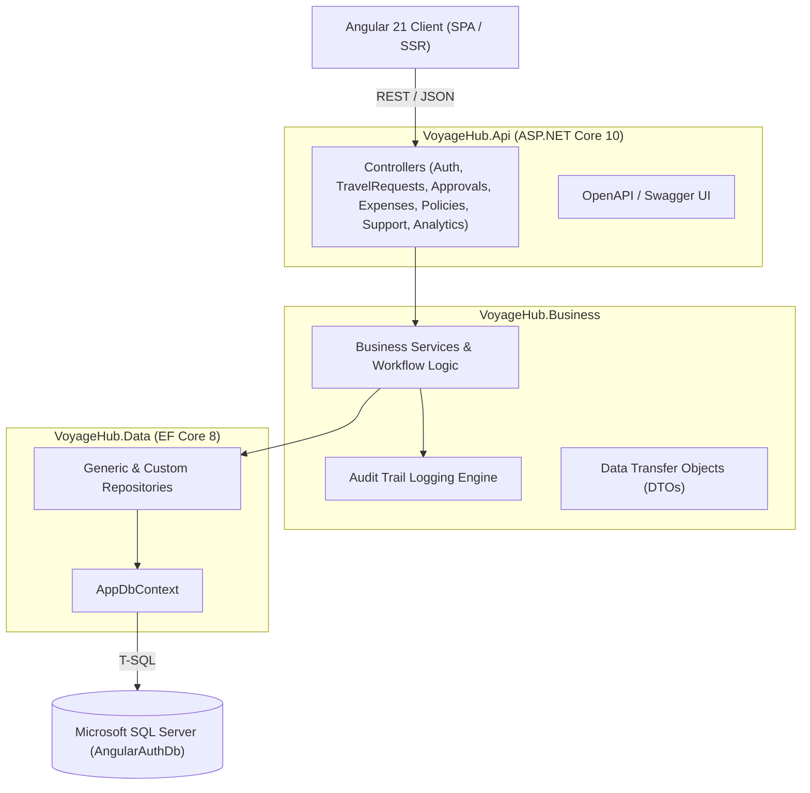

# VoyageHub — Corporate Travel & Expense Management System

[](https://dotnet.microsoft.com/)
[](https://angular.dev/)
[](https://learn.microsoft.com/ef/core/)
[](https://www.microsoft.com/sql-server)

**VoyageHub** is an enterprise-grade corporate travel and expense management application designed to streamline employee business travel requests, multi-tier approvals, expense claim reimbursements, departmental policy compliance, and internal corporate travel support workflows.

---

## Architecture Overview

VoyageHub is architected as a layered REST service paired with a modern Angular Single Page Application featuring Server-Side Rendering (SSR).



---

## Key Features & User Personas

| Persona | Core Capabilities |
| :--- | :--- |
| **Employee** | Create and submit travel requests, link itinerary segments and hotel stays, claim out-of-pocket expenses, submit receipts, and open support tickets. |
| **Line Manager** | Review pending team travel requests, inspect itinerary details and policy compliance flags, approve or reject with comments. |
| **Finance Officer** | Second-level approval on manager-approved requests, review itemized expense claims, and execute single or batch reimbursements. |
| **System Admin** | Set department domestic and international budget limits, flight class rules, enforcement flags, view complete system audit logs, and manage accounts. |

---

## Tech Stack

- **Backend**:
  - ASP.NET Core 10 Web API (`net10.0`)
  - Entity Framework Core 8.0 (`Microsoft.EntityFrameworkCore.SqlServer`)
  - BCrypt.Net-Next for password hashing
  - Swagger / OpenAPI (`Swashbuckle.AspNetCore`)
- **Frontend**:
  - Angular 21 (`@angular/core` ^21.2.0)
  - Angular Server-Side Rendering (SSR) via Express 5
  - Role-based Route Guards
- **Database**:
  - Microsoft SQL Server / Azure SQL

---

## Repository Structure

```
Project.NET/
├── Assets/                    # Architecture diagrams, ER models, SRS documentation
├── VoyageHub-Backend/         # .NET 10 Solution
│   ├── VoyageHub.Api/         # REST Controllers, Middleware, Configuration
│   ├── VoyageHub.Business/    # Business services, validation, workflow logic, DTOs
│   ├── VoyageHub.Data/        # EF Core DbContext, entity models, repositories
│   └── VoyageHub.slnx         # Solution file
├── VoyageHub-Frontend/        # Angular 21 SSR Client Application
│   ├── src/app/admin/         # Admin policy management & audit logs
│   ├── src/app/approvals/     # Manager & Finance approval queues
│   ├── src/app/dashboard/     # Unified role-based dashboard
│   ├── src/app/finance/       # Expense claims review & batch payout
│   ├── src/app/requests/      # Travel request creation & itineraries
│   └── src/app/support/       # Corporate desk support ticketing
├── VoyageHub_Schema.sql       # Database creation and seed data script
└── README.md                  # Project documentation
```

---

## Getting Started

### Prerequisites

- [.NET 10 SDK](https://dotnet.microsoft.com/download/dotnet/10.0)
- [Node.js 20+ LTS](https://nodejs.org/) & npm 10+
- [Angular CLI](https://angular.dev/tools/cli) (`npm install -g @angular/cli`)
- [Microsoft SQL Server](https://www.microsoft.com/sql-server) or SQL Server Express

---

### Step 1: Database Setup

1. Open SQL Server Management Studio (SSMS) or Azure Data Studio.
2. Connect to your SQL Server instance.
3. Open and execute the [VoyageHub_Schema.sql](file:///c:/Users/rajat/Downloads/Project.NET/VoyageHub_Schema.sql) script. This will:
   - Create the `AngularAuthDb` database (if not existing).
   - Create all 9 domain tables (`USERS`, `DEPARTMENTS`, `TRAVEL_POLICIES`, `TRAVEL_REQUESTS`, `APPROVAL_STEPS`, `ITINERARY_SEGMENTS`, `STAYS`, `EXPENSES`, `SUPPORT_TICKETS`, `AUDIT_LOGS`).
   - Populate initial seed data with departments, policies, and demo users.

---

### Step 2: Backend Configuration & Startup

1. Navigate to the API directory:
   ```bash
   cd VoyageHub-Backend/VoyageHub.Api
   ```
2. Verify or update the connection string in `appsettings.json` (see `appsettings.example.json`):
   ```json
   "ConnectionStrings": {
     "DefaultConnection": "Server=localhost;Database=AngularAuthDb;Trusted_Connection=True;TrustServerCertificate=True;"
   }
   ```
3. Restore packages and run the API:
   ```bash
   dotnet restore
   dotnet run
   ```
4. Access the Swagger documentation at:
   ```
   https://localhost:5001/swagger or http://localhost:5000/swagger
   ```

---

### Step 3: Frontend Startup

1. Open a new terminal and navigate to the frontend directory:
   ```bash
   cd VoyageHub-Frontend
   ```
2. Install dependencies:
   ```bash
   npm install
   ```
3. Start the Angular development server:
   ```bash
   npm start
   ```
4. Open your browser and navigate to:
   ```
   http://localhost:4200
   ```

---

### Demo Accounts

The database seed provides ready-to-use persona accounts:

| Role | Email | Password |
| :--- | :--- | :--- |
| **Admin** | `vikram@voyagehub.internal` | `admin123` |
| **Manager** | `priya@voyagehub.internal` | `password123` |
| **Finance** | `rohit@voyagehub.internal` | `password123` |
| **Employee** | `ananya@voyagehub.internal` | `password123` |

---

## License

This project is licensed under the MIT License.
