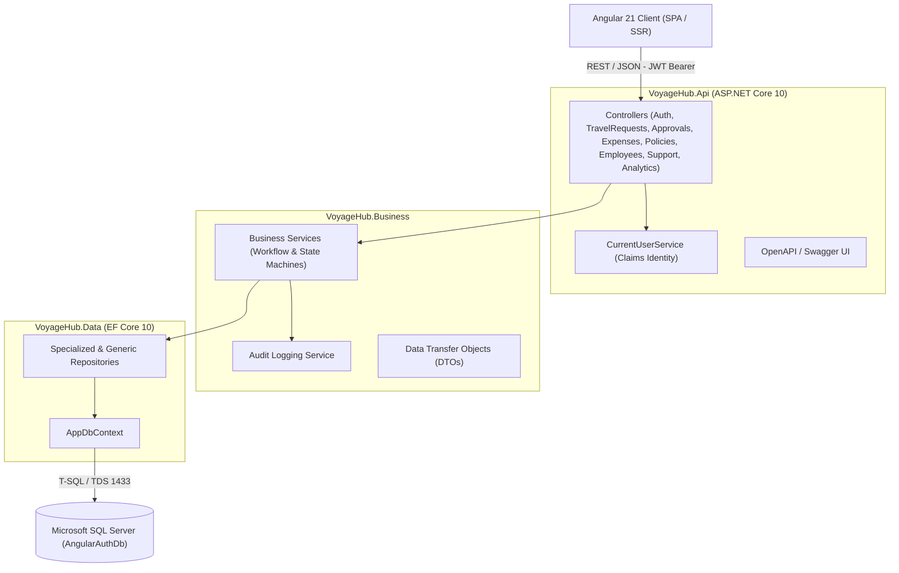

# VoyageHub — Corporate Travel & Expense Management System

[](https://dotnet.microsoft.com/)
[](https://learn.microsoft.com/ef/core/)
[](https://angular.dev/)
[](https://www.microsoft.com/sql-server)
[](docs/CODE-QUALITY.md)

**VoyageHub** is an enterprise corporate travel and expense management application engineered to coordinate corporate business travel requests, sequential multi-tier approvals, policy compliance verification, itemized expense reimbursement workflows, employee directory operations, and internal travel support ticketing. Built with ASP.NET Core 10, Entity Framework Core 10, and an Angular 21 Single Page Application with Server-Side Rendering (SSR), it provides strict token-based authorization and automated audit logging across all state transitions.

---

## Key Features by User Persona

| Persona | Core Capabilities |
| :--- | :--- |
| **Employee** | Create, edit, and submit travel requests; associate multi-segment flights, trains, and hotel stay reservations; track live approval status; submit expense reimbursement claims with receipt proof uploads; download uploaded receipts; and file corporate travel desk support inquiries. |
| **Line Manager** | Access team approval queue scoped strictly to direct reports and departmental requests; inspect estimated budgets against departmental policies; approve requests with routing to Finance; reject requests with reason comments; and view department travel summaries. |
| **Finance Officer** | Perform secondary financial review and approval on manager-approved travel requests; review submitted expense claims with attached proof receipts; execute single claim approvals/rejections; and process bulk reimbursement payouts. |
| **System Admin** | Configure departmental travel policy parameters (domestic/international budget ceilings, allowed flight classes, hard-limit enforcement flags); view complete system audit logs; manage employee directory records (create, edit, delete, CSV batch upload, and CSV template download); and oversee support desk ticketing. |

---

## Tech Stack & Versions

- **Backend (API & Business Core)**:
  - **Runtime & SDK**: .NET 10 (`net10.0`), C# 13
  - **Framework**: ASP.NET Core 10 Web API (`Microsoft.NET.Sdk.Web`)
  - **ORM & Data Access**: Microsoft Entity Framework Core 10 (`Microsoft.EntityFrameworkCore.SqlServer` `10.0.11`, `Microsoft.EntityFrameworkCore.Design` `10.0.11`)
  - **Security & Cryptography**: BCrypt.Net-Next (`4.2.0`), JWT Bearer Authentication (`Microsoft.AspNetCore.Authentication.JwtBearer` `10.0.11`, `System.IdentityModel.Tokens.Jwt` `7.7.1`)
  - **API Documentation**: OpenAPI / Swagger (`Swashbuckle.AspNetCore` `10.3.1`, `Microsoft.AspNetCore.OpenApi` `10.0.11`)
  - **Unit Testing**: xUnit (`2.9.3`), Moq (`4.20.72`), Microsoft.NET.Test.Sdk (`17.12.0`), EF Core InMemory/Sqlite (`10.0.11`)
- **Frontend (Client Application)**:
  - **Framework**: Angular 21 (`@angular/core` `^21.2.0`)
  - **SSR Server**: Angular Server-Side Rendering (`@angular/ssr` `^21.2.21`) powered by Express 5 (`^5.1.0`)
  - **State & Reactivity**: Angular Signals (`signal`, `computed`), RxJS (`~7.8.0`)
  - **Build & Language**: Angular CLI (`^21.2.21`), TypeScript (`~5.9.2`)
  - **Unit Testing**: Vitest (`^4.0.8`), `@vitest/coverage-v8` (`^4.1.12`), jsdom (`^28.0.0`)
- **Database**:
  - Microsoft SQL Server 2022 / Azure SQL Database (`AngularAuthDb`)

---

## Architecture Summary

VoyageHub implements a strict 3-tier backend architecture paired with an Angular SPA supporting both client-side rendering (CSR) and server-side rendering (SSR):



For complete architectural details, request lifecycles, and state machines, see [ARCHITECTURE.md](docs/ARCHITECTURE.md).

---

## Quick Start

### Prerequisites
- [.NET 10 SDK](https://dotnet.microsoft.com/download/dotnet/10.0) (verify with `dotnet --version`)
- [Node.js 20+ LTS](https://nodejs.org/) and npm 10+ (verify with `node -v` and `npm -v`)
- [Angular CLI 21](https://angular.dev/tools/cli) (`npm install -g @angular/cli`)
- [Microsoft SQL Server](https://www.microsoft.com/sql-server) (Local SQL Server, SQL Server Express, or Azure SQL)

---

### Step 1: Database Setup

Initialize the schema and seed data:

```powershell
# Option A: Run automated PowerShell setup script against local SQLEXPRESS
.\database\run_migration.ps1 -Server ".\SQLEXPRESS06" -Database "AngularAuthDb"

# Option B: Run via sqlcmd manually
sqlcmd -S ".\SQLEXPRESS06" -d master -E -i "database\VoyageHub_Schema.sql"
```

The script creates the `AngularAuthDb` database, defines all 10 domain tables (`USERS`, `DEPARTMENTS`, `TRAVEL_POLICIES`, `TRAVEL_REQUESTS`, `APPROVAL_STEPS`, `ITINERARY_SEGMENTS`, `STAYS`, `EXPENSES`, `SUPPORT_TICKETS`, `AUDIT_LOGS`), sets foreign key cascades, and seeds initial departments, policies, and demo users.

---

### Step 2: Run the Backend API

```powershell
cd VoyageHub-Backend\VoyageHub.Api

# Restore dependencies and build
dotnet restore
dotnet build

# Run API (defaults to Development environment)
dotnet run
```

- **API Base URL**: `http://localhost:5062` (HTTP) or `https://localhost:7213` (HTTPS)
- **Swagger UI**: Accessible in Development at `http://localhost:5062/swagger`

---

### Step 3: Run the Frontend Client

Open a second terminal window:

```powershell
cd VoyageHub-Frontend

# Install npm dependencies
npm install

# Start development dev-server
npm start
```

- **Client Application**: Accessible at `http://localhost:4200`

---

### Step 4: Run Tests Locally

#### Backend Tests (xUnit)
```powershell
dotnet test VoyageHub-Backend\VoyageHub.Tests\VoyageHub.Tests.csproj
```
*(Runs the xUnit unit and integration test suite covering services, controllers, and authorization logic.)*

#### Frontend Tests (Vitest)
```powershell
cd VoyageHub-Frontend
npm test
```
*(Runs the Vitest test suite and outputs coverage report to `coverage/AngularBasics/lcov.info`.)*

---

## Local Development Demo Accounts

> [!NOTE]
> **LOCAL DEVELOPMENT ONLY**: The credentials below apply strictly to local development environments seeded via `database/VoyageHub_Schema.sql`. For hosted and production deployments, all seed passwords are set to the disabled placeholder `'DISABLED-SET-VIA-DEPLOYMENT-MD'` in `database/VoyageHub_Schema.azure.sql` and must be initialized using `tools/HashPassword` (see [DEPLOYMENT.md](DEPLOYMENT.md) and [SECURITY.md](docs/SECURITY.md)).

| Persona | Email | Local Password | Default Department |
| :--- | :--- | :--- | :--- |
| **System Admin** | `admin@voyagehub.in` | `VoyageHub@2026` | Administration |
| **Line Manager** | `priya.nair@voyagehub.in` | `VoyageHub@2026` | Product Management |
| **Finance Officer** | `vikram.mehta@voyagehub.in` | `VoyageHub@2026` | Finance & Accounts |
| **Employee** | `aarav.patel@voyagehub.in` | `VoyageHub@2026` | Engineering |

---

## Code Quality & Test Metrics

Both projects in VoyageHub adhere to strict SonarQube Clean as You Code (CaYC) standards without suppressions or altered rules:

| Metric | Backend (`VoyageHub-Backend`) | Frontend (`VoyageHub-Frontend`) | Quality Gate Threshold | Status |
| :--- | :---: | :---: | :---: | :---: |
| **Quality Gate Status** | **OK (PASSED)** | **OK (PASSED)** | All conditions passing | **PASSED** |
| **Automated Tests** | **100% passing** (0 failed) | **100% passing** (0 failed) | 100% passing | **PASSED** |
| **Coverage on New Code** | **83.1%** | **100.0%** | $\ge 80.0\%$ | **PASSED** |
| **Duplications on New Code** | **0.0%** | **0.0%** | $\le 3.0\%$ | **PASSED** |
| **New Open Violations** | **0** | **0** | $= 0$ | **PASSED** |
| **Security Rating** | **A (`1.0`)** | **A (`1.0`)** | A | **PASSED** |
| **Reliability Rating** | **A (`1.0`)** | **A (`1.0`)** | A | **PASSED** |
| **Maintainability Rating** | **A (`1.0`)** | **A (`1.0`)** | A | **PASSED** |

For details on local Sonar scanner execution and historical quality gate remediation, see [docs/CODE-QUALITY.md](docs/CODE-QUALITY.md).

---

## Deployment Readiness

VoyageHub supports zero-friction deployment to free-tier cloud architectures as well as self-hosted container environments:
1. **Azure Free Tiers**: Azure Static Web Apps (CSR client), Azure App Service F1 (ASP.NET Core API), and Azure SQL Database Free Offer.
2. **MonsterASP.NET**: Single-site Windows IIS hosting serving pre-compiled static Angular assets from `wwwroot` alongside the .NET API.
3. **Local Docker + Tunnel**: Self-hosted container deployment with Cloudflare Tunnel or ngrok for remote review.

Key production safeguards:
- **Startup Fail-Fast Validation**: Aborts startup in production if connection strings are missing or if `Jwt:Key` is shorter than 32 characters (256 bits).
- **Environment-based CORS Isolation**: Excludes localhost origins by default in production and restricts access strictly to configured origins (`Cors__AllowedOrigins__0`).
- **Resilient Database Retries**: `EnableRetryOnFailure` is configured on EF Core to survive cloud database cold starts.

See [DEPLOYMENT.md](DEPLOYMENT.md) for step-by-step guides, configuration keys, and pre-demo checklists.

---

## Project Status & Known Limitations

- **Production Status**: Production-ready core with end-to-end travel request, approval, expense, employee management, and audit logging workflows implemented and verified with automated tests.
- **Simulated Third-Party Integrations**: External flight/hotel booking GDS engines and banking payout rails are intentionally simulated within domain services per design requirements; no real financial charges or live flight bookings occur.
- **Client Token Storage**: JWT tokens are currently stored in browser `localStorage` by the Angular client. See [SECURITY.md](docs/SECURITY.md) for mitigation analysis.
- **Swagger in Production**: Swagger UI is disabled by default in non-Development environments (`Swagger:Enabled: false`); the root endpoint `/` returns a lightweight HTTP 200 health check string.

---

## Documentation Index

- **Architecture & Design**:
  - [ARCHITECTURE.md](docs/ARCHITECTURE.md) — System layers, request flows, authentication lifecycles, and approval state machine.
  - [DATABASE.md](docs/DATABASE.md) — Entity-relationship diagram, table schemas, seed data, and migration workflows.
  - [UI-GUIDELINES.md](docs/UI-GUIDELINES.md) — 4px spacing tokens, typography, layout primitives, and component patterns.
  - [decisions/](docs/decisions/) — Architecture Decision Records (ADRs) for key technical choices.
- **API & Security**:
  - [API.md](docs/API.md) — Complete endpoint catalog, HTTP verbs, role requirements, and payload shapes.
  - [SECURITY.md](docs/SECURITY.md) — JWT authentication, role-based access matrix, password hashing, and CORS isolation.
  - [CONFIGURATION.md](docs/CONFIGURATION.md) — Environment variables, appsettings keys, and precedence hierarchy.
- **Operations & Verification**:
  - [DEPLOYMENT.md](DEPLOYMENT.md) — Azure free-tier guide, MonsterASP.NET guide, Docker setup, and pre-demo checklist.
  - [TESTING.md](docs/TESTING.md) — xUnit and Vitest test suites, test catalog, and code coverage workflows.
  - [CODE-QUALITY.md](docs/CODE-QUALITY.md) — SonarQube setup, scan commands, and Quality Gate metrics.
  - [REQUIREMENTS-TRACEABILITY.md](docs/REQUIREMENTS-TRACEABILITY.md) — Mapping original specifications to implementation files and tests.
  - [DEMO.md](docs/DEMO.md) — Guided role-based demonstration scripts and warm-up checklist.
  - [GIT-WORKFLOW.md](docs/GIT-WORKFLOW.md) — Branching models, Conventional Commits, tags, and PR standards.
  - [CONTRIBUTING.md](CONTRIBUTING.md) — Guidelines for contributing code and running pre-flight checks.
  - [CHANGELOG.md](CHANGELOG.md) — Chronological history of releases and milestones.
  - [context.md](context.md) — Formal system context and acceptance criteria specification.
