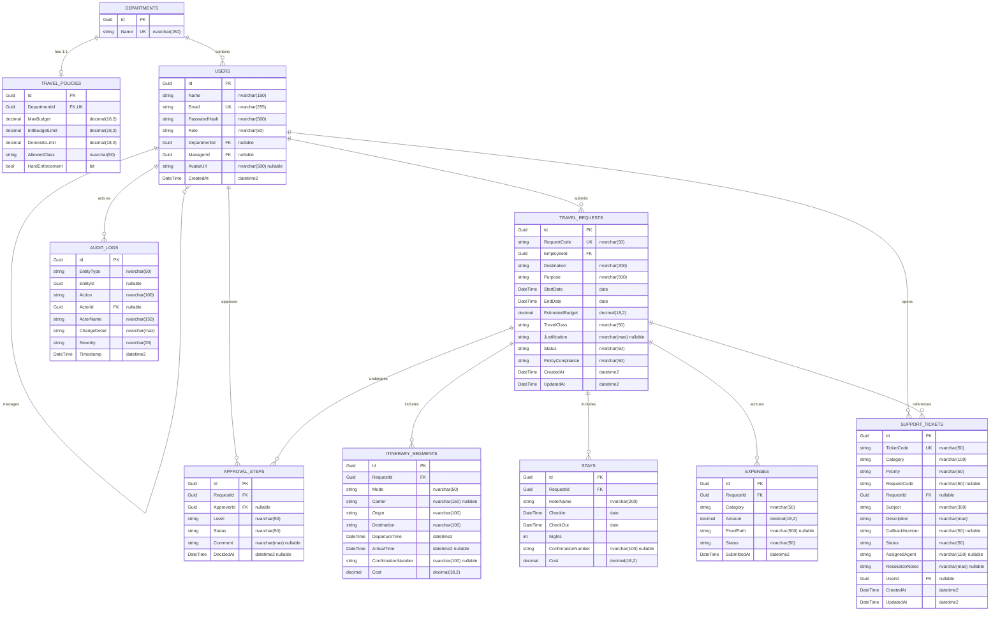
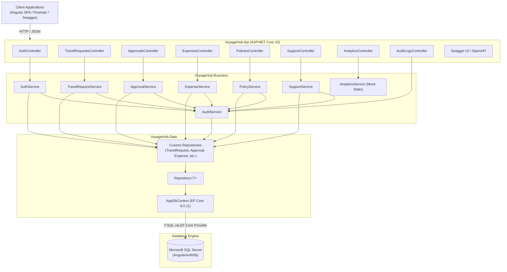

# VoyageHub System Context & Specification

## 1. Overview
[VoyageHub](file:///C:/Users/rajat/Downloads/Project.NET/VoyageHub/VoyageHub.slnx) is a corporate travel and expense management backend API designed to coordinate employee travel requests, multi-tier approvals, expense reimbursements, travel policies, and corporate support workflows. The system serves four distinct user personas: traveling employees, line managers, finance officers, and corporate system administrators. **[Verified]**

- **Project Type**: ASP.NET Core Web API (layered REST service without built-in UI; intended to serve an external Angular SPA client). **[Verified: [Program.cs](file:///C:/Users/rajat/Downloads/Project.NET/VoyageHub/VoyageHub.Api/Program.cs#L37-L51)]**
- **Technology Stack & Versions**:
  - Runtime: .NET 10 (`net10.0`). **[Verified: [VoyageHub.Api.csproj](file:///C:/Users/rajat/Downloads/Project.NET/VoyageHub/VoyageHub.Api/VoyageHub.Api.csproj#L4)]**
  - Web Framework: ASP.NET Core 10 (`Microsoft.NET.Sdk.Web`). **[Verified: [VoyageHub.Api.csproj](file:///C:/Users/rajat/Downloads/Project.NET/VoyageHub/VoyageHub.Api/VoyageHub.Api.csproj#L1)]**
  - Database & ORM: Microsoft Entity Framework Core 8.0.11 with SQL Server provider (`Microsoft.EntityFrameworkCore.SqlServer` v8.0.11). **[Verified: [VoyageHub.Data.csproj](file:///C:/Users/rajat/Downloads/Project.NET/VoyageHub/VoyageHub.Data/VoyageHub.Data.csproj#L10)]**
  - Security / Hashing: BCrypt.Net-Next v4.2.0. **[Verified: [VoyageHub.Business.csproj](file:///C:/Users/rajat/Downloads/Project.NET/VoyageHub/VoyageHub.Business/VoyageHub.Business.csproj#L14)]**
  - API Documentation: Swashbuckle / OpenAPI (`Microsoft.AspNetCore.OpenApi` v10.0.11, `Swashbuckle.AspNetCore` v10.3.1). **[Verified: [VoyageHub.Api.csproj](file:///C:/Users/rajat/Downloads/Project.NET/VoyageHub/VoyageHub.Api/VoyageHub.Api.csproj#L15-L16)]**
- **Current Maturity**: **Working Demo / Early Prototype**. The solution compiles without errors and provides working CRUD endpoints over EF Core, but features simulated analytics, hardcoded fallback metrics, hardcoded actor names, backdoor password overrides, and no authentication token issuance or unit tests. **[Verified: [AnalyticsService.cs](file:///C:/Users/rajat/Downloads/Project.NET/VoyageHub/VoyageHub.Business/Services/AnalyticsService.cs#L12-L39), [AuthService.cs](file:///C:/Users/rajat/Downloads/Project.NET/VoyageHub/VoyageHub.Business/Services/AuthService.cs#L54-L57)]**

---

## 2. Constitution (Rules the Project Follows)

| Rule | Specification & Convention | Evidence / Source File | Status |
| :--- | :--- | :--- | :--- |
| **Architecture Style** | Three-tier layered architecture: Presentation/API (`VoyageHub.Api`), Business logic and DTOs (`VoyageHub.Business`), Data access and EF Core models (`VoyageHub.Data`). | [VoyageHub.slnx](file:///C:/Users/rajat/Downloads/Project.NET/VoyageHub/VoyageHub.slnx#L1-L5) | Verified |
| **Dependency Direction** | Api references Business and Data; Business references Data; Data has no internal project dependencies. | [VoyageHub.Api.csproj](file:///C:/Users/rajat/Downloads/Project.NET/VoyageHub/VoyageHub.Api/VoyageHub.Api.csproj#L9-L12), [VoyageHub.Business.csproj](file:///C:/Users/rajat/Downloads/Project.NET/VoyageHub/VoyageHub.Business/VoyageHub.Business.csproj#L9-L11) | Verified |
| **Data Layer Abstraction** | Generic repository interface `IRepository<T>` extended by specialized repository interfaces (`ITravelRequestRepository`, etc.) backed by `AppDbContext`. | [IRepository.cs](file:///C:/Users/rajat/Downloads/Project.NET/VoyageHub/VoyageHub.Data/Repositories/IRepository.cs#L8-L16), [Repository.cs](file:///C:/Users/rajat/Downloads/Project.NET/VoyageHub/VoyageHub.Data/Repositories/Repository.cs#L9-L49) | Verified |
| **DI Lifetime** | All repositories and business services are registered with `Scoped` lifetime sharing one `AppDbContext` instance per HTTP request. | [Program.cs](file:///C:/Users/rajat/Downloads/Project.NET/VoyageHub/VoyageHub.Api/Program.cs#L12-L28) | Verified |
| **Casing & Serialization** | API responses serialize JSON property names using `CamelCase`. | [Program.cs](file:///C:/Users/rajat/Downloads/Project.NET/VoyageHub/VoyageHub.Api/Program.cs#L32-L35) | Verified |
| **Database Table Naming** | Relational database tables and constraints strictly follow uppercase snake_case / uppercase naming conventions (`USERS`, `DEPARTMENTS`, `TRAVEL_REQUESTS`, `APPROVAL_STEPS`, `ITINERARY_SEGMENTS`, `STAYS`, `EXPENSES`, `TRAVEL_POLICIES`, `AUDIT_LOGS`, `SUPPORT_TICKETS`). | [AppDbContext.cs](file:///C:/Users/rajat/Downloads/Project.NET/VoyageHub/VoyageHub.Data/AppDbContext.cs#L27-L162) | Verified |
| **Global Usings Pattern** | Each project defines common namespace imports inside a root `GlobalUsings.cs` file. | [VoyageHub.Api/GlobalUsings.cs](file:///C:/Users/rajat/Downloads/Project.NET/VoyageHub/VoyageHub.Api/GlobalUsings.cs#L1-L4), [VoyageHub.Business/GlobalUsings.cs](file:///C:/Users/rajat/Downloads/Project.NET/VoyageHub/VoyageHub.Business/GlobalUsings.cs#L1-L5) | Verified |
| **Async & Cancellation** | Asynchronous service and repository methods accept an optional `CancellationToken` defaulting to `default`. | [ITravelRequestService.cs](file:///C:/Users/rajat/Downloads/Project.NET/VoyageHub/VoyageHub.Business/Services/ITravelRequestService.cs#L13-L25) | Verified |
| **Audit Logging Pattern** | State-altering domain actions trigger synchronous or awaited audit log records via `IAuditService.LogAsync()`. | [TravelRequestService.cs](file:///C:/Users/rajat/Downloads/Project.NET/VoyageHub/VoyageHub.Business/Services/TravelRequestService.cs#L257-L266), [ApprovalService.cs](file:///C:/Users/rajat/Downloads/Project.NET/VoyageHub/VoyageHub.Business/Services/ApprovalService.cs#L107-L116) | Verified |
| **Intentional Fallback Shortcut** | Repositories and services fall back to hardcoded mock sums or mock strings when queried entities or aggregations return null or empty. | [TravelRequestRepository.cs](file:///C:/Users/rajat/Downloads/Project.NET/VoyageHub/VoyageHub.Data/Repositories/TravelRequestRepository.cs#L83), [ExpenseRepository.cs](file:///C:/Users/rajat/Downloads/Project.NET/VoyageHub/VoyageHub.Data/Repositories/ExpenseRepository.cs#L41) | Verified |
| **Intentional Backdoor Shortcut** | Authentication service deliberately permits predefined bypass passwords during credential verification for testing or demonstration purposes. | [AuthService.cs](file:///C:/Users/rajat/Downloads/Project.NET/VoyageHub/VoyageHub.Business/Services/AuthService.cs#L54-L57) | Verified |

---

## 3. Functional Requirements (As Built)

| ID | Requirement Statement | Status | Source Files | Confidence |
| :--- | :--- | :--- | :--- | :--- |
| **AUTH-01** | The system shall authenticate users by verifying email and hashed password, returning a profile DTO without an authorization token. | Implemented | [AuthController.cs](file:///C:/Users/rajat/Downloads/Project.NET/VoyageHub/VoyageHub.Api/Controllers/AuthController.cs#L24-L41), [AuthService.cs](file:///C:/Users/rajat/Downloads/Project.NET/VoyageHub/VoyageHub.Business/Services/AuthService.cs#L23-L87) | Verified |
| **AUTH-02** | The system shall bypass BCrypt verification if the entered password matches designated bypass test strings (`password123`, `password`, `admin123`). | Implemented | [AuthService.cs](file:///C:/Users/rajat/Downloads/Project.NET/VoyageHub/VoyageHub.Business/Services/AuthService.cs#L54-L57) | Verified |
| **AUTH-03** | The system shall return a list of all user personas with department information for quick demo switching. | Implemented | [AuthController.cs](file:///C:/Users/rajat/Downloads/Project.NET/VoyageHub/VoyageHub.Api/Controllers/AuthController.cs#L43-L48), [AuthService.cs](file:///C:/Users/rajat/Downloads/Project.NET/VoyageHub/VoyageHub.Business/Services/AuthService.cs#L89-L104) | Verified |
| **AUTH-04** | The system shall allow updating a user's full name and avatar URL, ignoring extended preference fields. | Partial | [AuthController.cs](file:///C:/Users/rajat/Downloads/Project.NET/VoyageHub/VoyageHub.Api/Controllers/AuthController.cs#L50-L67), [AuthService.cs](file:///C:/Users/rajat/Downloads/Project.NET/VoyageHub/VoyageHub.Business/Services/AuthService.cs#L106-L160) | Verified |
| **AUTH-05** | The system shall allow users to change passwords by validating current credentials and storing new BCrypt hashes. | Implemented | [AuthController.cs](file:///C:/Users/rajat/Downloads/Project.NET/VoyageHub/VoyageHub.Api/Controllers/AuthController.cs#L69-L86), [AuthService.cs](file:///C:/Users/rajat/Downloads/Project.NET/VoyageHub/VoyageHub.Business/Services/AuthService.cs#L162-L214) | Verified |
| **TRV-01** | The system shall list travel requests filtered by status, search keyword, employee ID, and result count limit. | Implemented | [TravelRequestsController.cs](file:///C:/Users/rajat/Downloads/Project.NET/VoyageHub/VoyageHub.Api/Controllers/TravelRequestsController.cs#L24-L33), [TravelRequestRepository.cs](file:///C:/Users/rajat/Downloads/Project.NET/VoyageHub/VoyageHub.Data/Repositories/TravelRequestRepository.cs#L17-L64) | Verified |
| **TRV-02** | The system shall return aggregated dashboard counts (drafts, pending, upcoming trips, pending reimbursement total) with non-zero fallback minimums. | Implemented | [TravelRequestsController.cs](file:///C:/Users/rajat/Downloads/Project.NET/VoyageHub/VoyageHub.Api/Controllers/TravelRequestsController.cs#L35-L40), [TravelRequestService.cs](file:///C:/Users/rajat/Downloads/Project.NET/VoyageHub/VoyageHub.Business/Services/TravelRequestService.cs#L62-L73) | Verified |
| **TRV-03** | The system shall retrieve detailed travel request records including itineraries, hotel stays, expenses, and approval history steps. | Implemented | [TravelRequestsController.cs](file:///C:/Users/rajat/Downloads/Project.NET/VoyageHub/VoyageHub.Api/Controllers/TravelRequestsController.cs#L42-L48), [TravelRequestService.cs](file:///C:/Users/rajat/Downloads/Project.NET/VoyageHub/VoyageHub.Business/Services/TravelRequestService.cs#L75-L150) | Verified |
| **TRV-04** | The system shall create travel requests as either "Draft" or "In Review", auto-flagging compliance against department international budget limits. | Implemented | [TravelRequestsController.cs](file:///C:/Users/rajat/Downloads/Project.NET/VoyageHub/VoyageHub.Api/Controllers/TravelRequestsController.cs#L50-L59), [TravelRequestService.cs](file:///C:/Users/rajat/Downloads/Project.NET/VoyageHub/VoyageHub.Business/Services/TravelRequestService.cs#L152-L280) | Verified |
| **TRV-05** | The system shall submit existing draft travel requests into "Manager Review", generating pending manager steps and waiting finance steps. | Implemented | [TravelRequestsController.cs](file:///C:/Users/rajat/Downloads/Project.NET/VoyageHub/VoyageHub.Api/Controllers/TravelRequestsController.cs#L69-L74), [TravelRequestService.cs](file:///C:/Users/rajat/Downloads/Project.NET/VoyageHub/VoyageHub.Business/Services/TravelRequestService.cs#L304-L357) | Verified |
| **TRV-06** | The system shall cancel an active travel request and record an audit log event. | Implemented | [TravelRequestsController.cs](file:///C:/Users/rajat/Downloads/Project.NET/VoyageHub/VoyageHub.Api/Controllers/TravelRequestsController.cs#L61-L67), [TravelRequestService.cs](file:///C:/Users/rajat/Downloads/Project.NET/VoyageHub/VoyageHub.Business/Services/TravelRequestService.cs#L282-L302) | Verified |
| **TRV-07** | The system shall allow appending individual itinerary segments and stay records to an existing travel request. | Implemented | [TravelRequestsController.cs](file:///C:/Users/rajat/Downloads/Project.NET/VoyageHub/VoyageHub.Api/Controllers/TravelRequestsController.cs#L76-L91), [TravelRequestService.cs](file:///C:/Users/rajat/Downloads/Project.NET/VoyageHub/VoyageHub.Business/Services/TravelRequestService.cs#L359-L411) | Verified |
| **TRV-08** | The system shall close an existing travel request by updating its status to "Completed". | Implemented | [TravelRequestsController.cs](file:///C:/Users/rajat/Downloads/Project.NET/VoyageHub/VoyageHub.Api/Controllers/TravelRequestsController.cs#L92-L98), [TravelRequestService.cs](file:///C:/Users/rajat/Downloads/Project.NET/VoyageHub/VoyageHub.Business/Services/TravelRequestService.cs#L413-L433) | Verified |
| **APPR-01** | The system shall retrieve pending approval queue items filtered by approver ID or role (Manager / Finance) with summary metrics. | Implemented | [ApprovalsController.cs](file:///C:/Users/rajat/Downloads/Project.NET/VoyageHub/VoyageHub.Api/Controllers/ApprovalsController.cs#L21-L29), [ApprovalService.cs](file:///C:/Users/rajat/Downloads/Project.NET/VoyageHub/VoyageHub.Business/Services/ApprovalService.cs#L23-L53) | Verified |
| **APPR-02** | The system shall execute approval decisions: promoting Manager approval to Finance Review, finalizing Finance approval to Approved, or rejecting requests and cancelling remaining steps. | Implemented | [ApprovalsController.cs](file:///C:/Users/rajat/Downloads/Project.NET/VoyageHub/VoyageHub.Api/Controllers/ApprovalsController.cs#L31-L41), [ApprovalService.cs](file:///C:/Users/rajat/Downloads/Project.NET/VoyageHub/VoyageHub.Business/Services/ApprovalService.cs#L55-L121) | Verified |
| **EXP-01** | The system shall retrieve pending expense claims filtered by category and high-priority threshold (>= 10,000 INR). | Implemented | [ExpensesController.cs](file:///C:/Users/rajat/Downloads/Project.NET/VoyageHub/VoyageHub.Api/Controllers/ExpensesController.cs#L22-L30), [ExpenseService.cs](file:///C:/Users/rajat/Downloads/Project.NET/VoyageHub/VoyageHub.Business/Services/ExpenseService.cs#L23-L48) | Verified |
| **EXP-02** | The system shall accept expense claims linked to a travel request and auto-assign dummy receipt proof paths if none provided. | Implemented | [ExpensesController.cs](file:///C:/Users/rajat/Downloads/Project.NET/VoyageHub/VoyageHub.Api/Controllers/ExpensesController.cs#L32-L42), [ExpenseService.cs](file:///C:/Users/rajat/Downloads/Project.NET/VoyageHub/VoyageHub.Business/Services/ExpenseService.cs#L50-L83) | Verified |
| **EXP-03** | The system shall process individual expense approvals ("Reimbursed") or rejections ("Rejected") with hardcoded actor attribution. | Implemented | [ExpensesController.cs](file:///C:/Users/rajat/Downloads/Project.NET/VoyageHub/VoyageHub.Api/Controllers/ExpensesController.cs#L44-L54), [ExpenseService.cs](file:///C:/Users/rajat/Downloads/Project.NET/VoyageHub/VoyageHub.Business/Services/ExpenseService.cs#L85-L109) | Verified |
| **EXP-04** | The system shall batch payout pending expenses, marking all specified or all pending claims as "Reimbursed". | Implemented | [ExpensesController.cs](file:///C:/Users/rajat/Downloads/Project.NET/VoyageHub/VoyageHub.Api/Controllers/ExpensesController.cs#L56-L61), [ExpenseService.cs](file:///C:/Users/rajat/Downloads/Project.NET/VoyageHub/VoyageHub.Business/Services/ExpenseService.cs#L111-L133) | Verified |
| **POL-01** | The system shall list all department travel policies with domestic, international, allowed class, and enforcement parameters. | Implemented | [PoliciesController.cs](file:///C:/Users/rajat/Downloads/Project.NET/VoyageHub/VoyageHub.Api/Controllers/PoliciesController.cs#L22-L27), [PolicyService.cs](file:///C:/Users/rajat/Downloads/Project.NET/VoyageHub/VoyageHub.Business/Services/PolicyService.cs#L23-L37) | Verified |
| **POL-02** | The system shall update policy limits and flight class settings for an existing policy ID. | Implemented | [PoliciesController.cs](file:///C:/Users/rajat/Downloads/Project.NET/VoyageHub/VoyageHub.Api/Controllers/PoliciesController.cs#L29-L39), [PolicyService.cs](file:///C:/Users/rajat/Downloads/Project.NET/VoyageHub/VoyageHub.Business/Services/PolicyService.cs#L39-L65) | Verified |
| **POL-03** | The system shall create travel policies for existing or newly instantiated departments, preventing duplicate policies per department. | Implemented | [PoliciesController.cs](file:///C:/Users/rajat/Downloads/Project.NET/VoyageHub/VoyageHub.Api/Controllers/PoliciesController.cs#L41-L51), [PolicyService.cs](file:///C:/Users/rajat/Downloads/Project.NET/VoyageHub/VoyageHub.Business/Services/PolicyService.cs#L67-L123) | Verified |
| **POL-04** | The system shall delete a travel policy by ID while preserving the parent department. | Implemented | [PoliciesController.cs](file:///C:/Users/rajat/Downloads/Project.NET/VoyageHub/VoyageHub.Api/Controllers/PoliciesController.cs#L53-L63), [PolicyService.cs](file:///C:/Users/rajat/Downloads/Project.NET/VoyageHub/VoyageHub.Business/Services/PolicyService.cs#L125-L147) | Verified |
| **SUP-01** | The system shall list support tickets filtered by status, user ID, or search terms across code, subject, category, and request code. | Implemented | [SupportController.cs](file:///C:/Users/rajat/Downloads/Project.NET/VoyageHub/VoyageHub.Api/Controllers/SupportController.cs#L24-L41), [SupportService.cs](file:///C:/Users/rajat/Downloads/Project.NET/VoyageHub/VoyageHub.Business/Services/SupportService.cs#L23-L46) | Verified |
| **SUP-02** | The system shall retrieve an individual support ticket by unique GUID ID. | Implemented | [SupportController.cs](file:///C:/Users/rajat/Downloads/Project.NET/VoyageHub/VoyageHub.Api/Controllers/SupportController.cs#L43-L61), [SupportService.cs](file:///C:/Users/rajat/Downloads/Project.NET/VoyageHub/VoyageHub.Business/Services/SupportService.cs#L48-L72) | Verified |
| **SUP-03** | The system shall create support tickets, generating unique ticket codes (`#TICK-xxxx`), linking optional travel requests, and auto-assigning default travel agents. | Implemented | [SupportController.cs](file:///C:/Users/rajat/Downloads/Project.NET/VoyageHub/VoyageHub.Api/Controllers/SupportController.cs#L63-L81), [SupportService.cs](file:///C:/Users/rajat/Downloads/Project.NET/VoyageHub/VoyageHub.Business/Services/SupportService.cs#L74-L160) | Verified |
| **SUP-04** | The system shall update ticket status, resolution notes, and assigned agents. | Implemented | [SupportController.cs](file:///C:/Users/rajat/Downloads/Project.NET/VoyageHub/VoyageHub.Api/Controllers/SupportController.cs#L83-L101), [SupportService.cs](file:///C:/Users/rajat/Downloads/Project.NET/VoyageHub/VoyageHub.Business/Services/SupportService.cs#L162-L196) | Verified |
| **ANL-01** | The system shall return high-level spend analytics, period comparisons, monthly breakdown, department spend, and category distributions. | Stubbed | [AnalyticsController.cs](file:///C:/Users/rajat/Downloads/Project.NET/VoyageHub/VoyageHub.Api/Controllers/AnalyticsController.cs#L20-L25), [AnalyticsService.cs](file:///C:/Users/rajat/Downloads/Project.NET/VoyageHub/VoyageHub.Business/Services/AnalyticsService.cs#L10-L42) | Verified |
| **AUD-01** | The system shall retrieve system audit trail logs filtered by severity, entity type, and limit count. | Implemented | [AuditLogsController.cs](file:///C:/Users/rajat/Downloads/Project.NET/VoyageHub/VoyageHub.Api/Controllers/AuditLogsController.cs#L21-L30), [AuditService.cs](file:///C:/Users/rajat/Downloads/Project.NET/VoyageHub/VoyageHub.Business/Services/AuditService.cs#L21-L36) | Verified |

---

## 4. Acceptance Criteria

### Authentication & Profile
- **AUTH-01 / AUTH-02**:
  - `Given` a user email `vikram@voyagehub.internal` and password `admin123`,
  - `When` a POST request is sent to `/api/Auth/login`,
  - `Then` the system shall return status HTTP 200 with `Success = true`, user profile object, and message `"Welcome back, Vikram Malhotra!"` even if the BCrypt hash does not match `admin123`. **[Verified: [AuthService.cs](file:///C:/Users/rajat/Downloads/Project.NET/VoyageHub/VoyageHub.Business/Services/AuthService.cs#L54-L86)]**
- **AUTH-01**:
  - `Given` empty or whitespace strings for email or password,
  - `When` a POST request is sent to `/api/Auth/login`,
  - `Then` the system shall return HTTP 400 with `Success = false` and message `"Email and password are required."`. **[Verified: [AuthService.cs](file:///C:/Users/rajat/Downloads/Project.NET/VoyageHub/VoyageHub.Business/Services/AuthService.cs#L25-L32)]**
- **AUTH-04**:
  - `Given` a valid user GUID and a payload containing `Fullname`, `AvatarUrl`, and extended preferences (`SeatPreference`, `MealPreference`),
  - `When` a PUT request is sent to `/api/Auth/profile`,
  - `Then` the system shall update only the `Name` and `AvatarUrl` in the `USERS` table, record a `LOW` severity audit log under entity type `ACCESS`, and return HTTP 200 with the updated profile. **[Verified: [AuthService.cs](file:///C:/Users/rajat/Downloads/Project.NET/VoyageHub/VoyageHub.Business/Services/AuthService.cs#L119-L160)]**

### Travel Requests & Submissions
- **TRV-04**:
  - `Given` a valid employee in a department with `IntlBudgetLimit = 3000.00` and a new request payload with `EstimatedBudget = 5000.00` and `SaveAsDraft = false`,
  - `When` a POST request is sent to `/api/TravelRequests`,
  - `Then` the request is created with `Status = "In Review"`, `PolicyCompliance = "Flagged"`, auto-generated RequestCode matching `#TR-{2050 + count + 1}`, and linked ApprovalSteps for Manager and Finance. **[Verified: [TravelRequestService.cs](file:///C:/Users/rajat/Downloads/Project.NET/VoyageHub/VoyageHub.Business/Services/TravelRequestService.cs#L167-L253)]**
- **TRV-05**:
  - `Given` a travel request with `Status = "Draft"`,
  - `When` a POST request is sent to `/api/TravelRequests/{id}/submit`,
  - `Then` any previous approval steps are removed, `Status` transitions to `"Manager Review"`, a `Manager` approval step is set to `"Pending"`, and a `Finance` step is set to `"Waiting"`. **[Verified: [TravelRequestService.cs](file:///C:/Users/rajat/Downloads/Project.NET/VoyageHub/VoyageHub.Business/Services/TravelRequestService.cs#L309-L343)]**
- **TRV-05**:
  - `Given` a travel request with `Status != "Draft"`,
  - `When` a POST request is sent to `/api/TravelRequests/{id}/submit`,
  - `Then` the endpoint shall return HTTP 400 with message `"Only Draft requests can be submitted."`. **[Verified: [TravelRequestService.cs](file:///C:/Users/rajat/Downloads/Project.NET/VoyageHub/VoyageHub.Business/Services/TravelRequestService.cs#L309)]**

### Approvals
- **APPR-02**:
  - `Given` an approval step with `Level = "Manager"` and `Status = "Pending"` for a travel request,
  - `When` an action payload `{ "action": "Approve", "comment": "Approved" }` is posted to `/api/Approvals/{stepId}/action`,
  - `Then` the step transitions to `"Approved"`, the request status becomes `"Finance Review"`, the existing Finance step transitions to `"Pending"`, and an audit log with entity type `APPROVAL` is inserted. **[Verified: [ApprovalService.cs](file:///C:/Users/rajat/Downloads/Project.NET/VoyageHub/VoyageHub.Business/Services/ApprovalService.cs#L63-L85)]**
- **APPR-02**:
  - `Given` an approval step with `Status = "Pending"`,
  - `When` an action payload `{ "action": "Reject", "comment": "Budget exceeded" }` is posted to `/api/Approvals/{stepId}/action`,
  - `Then` the step transitions to `"Rejected"`, the travel request status becomes `"Rejected"`, and all other non-approved steps for that request are marked `"Cancelled"`. **[Verified: [ApprovalService.cs](file:///C:/Users/rajat/Downloads/Project.NET/VoyageHub/VoyageHub.Business/Services/ApprovalService.cs#L95-L104)]**

### Expenses & Batch Payout
- **EXP-03**:
  - `Given` a pending expense claim with a valid GUID,
  - `When` a POST request is sent to `/api/Expenses/{id}/action` with `{ "action": "Approve" }`,
  - `Then` the expense `Status` is updated to `"Reimbursed"`, an audit record attributed to `"Vikram Malhotra (Finance)"` is saved, and HTTP 200 with `{ "success": true, "message": "Expense claim reimbursed." }` is returned. **[Verified: [ExpenseService.cs](file:///C:/Users/rajat/Downloads/Project.NET/VoyageHub/VoyageHub.Business/Services/ExpenseService.cs#L85-L109)]**
- **EXP-04**:
  - `Given` a list of pending expense GUIDs in `BatchPayoutDto.ExpenseIds`,
  - `When` a POST request is sent to `/api/Expenses/batch-payout`,
  - `Then` each matching pending expense status is changed to `"Reimbursed"` and an audit log is created recording the count and total reimbursement amount. **[Verified: [ExpenseService.cs](file:///C:/Users/rajat/Downloads/Project.NET/VoyageHub/VoyageHub.Business/Services/ExpenseService.cs#L111-L133)]**

### Policies
- **POL-03**:
  - `Given` a `CreatePolicyDto` with a `DepartmentName` that already possesses a travel policy in the database,
  - `When` a POST request is sent to `/api/Policies`,
  - `Then` the system shall abort creation and return HTTP 400 with message `"A policy already exists for this department."`. **[Verified: [PolicyService.cs](file:///C:/Users/rajat/Downloads/Project.NET/VoyageHub/VoyageHub.Business/Services/PolicyService.cs#L83-L86)]**

### Support Tickets
- **SUP-03**:
  - `Given` a `CreateSupportTicketDto` with `Subject` and `Description`,
  - `When` a POST request is sent to `/api/Support/tickets`,
  - `Then` the system generates a ticket code matching `#TICK-{1000..9999}`, assigns agent `"Meera Sen (Corporate Travel Desk)"`, sets status `"Open"`, records an audit log, and returns HTTP 200 with the created ticket DTO. **[Verified: [SupportService.cs](file:///C:/Users/rajat/Downloads/Project.NET/VoyageHub/VoyageHub.Business/Services/SupportService.cs#L74-L160)]**

---

## 5. Non-Functional Requirements (As Built)

| Dimension | What Exists in Code | What Is Absent / Missing | Confidence |
| :--- | :--- | :--- | :--- |
| **Authentication & Session** | Single login endpoint `/api/Auth/login` returning user profile; BCrypt hash validation. | **Absent**: JWT token generation, session cookies, bearer token validation, OAuth/OIDC handlers, token refresh logic. No `builder.Services.AddAuthentication()` configured. **[Verified: [Program.cs](file:///C:/Users/rajat/Downloads/Project.NET/VoyageHub/VoyageHub.Api/Program.cs#L6-L65)]** | Verified |
| **Authorization & Access Control** | `app.UseAuthorization()` is invoked in middleware pipeline. Roles (`Employee`, `Manager`, `Finance`, `Admin`) defined as constants. | **Absent**: `[Authorize]` or role-based attribute filters on all controllers and action methods. Any unauthenticated caller can invoke all endpoints. | Verified |
| **Input Validation** | Ad-hoc null and empty string checks in service methods (e.g. email/password in `AuthService`, subject/description in `SupportService`). EF Core MaxLength attributes on entities. | **Absent**: FluentValidation, DataAnnotation validation filters on action inputs, validation of date ranges (`StartDate <= EndDate`), budget limits (`> 0`). | Verified |
| **CSRF & Injection Protection** | EF Core parameterized SQL queries via LINQ prevent SQL injection on database operations. | **Absent**: Antiforgery tokens (CSRF) for state-changing endpoints (relies entirely on CORS preflight). | Verified |
| **CORS Policy** | Explicit CORS policy `"AllowAngularApp"` permitting `http://localhost:4200`, `http://127.0.0.1:4200`, `https://localhost:4200` with credentials, any header, and any method. | **Absent**: Dynamic or configurable production origin lists via `appsettings.json`. | Verified |
| **Performance & Caching** | Read queries leverage `.AsNoTracking()` in repositories (`TravelRequestRepository`, `ApprovalStepRepository`, `AuditLogRepository`, `PolicyRepository`, `SupportTicketRepository`). | **Absent**: Output caching, in-memory caching (`IMemoryCache`), Redis distributed caching, or pagination metadata (skip/take offset tokens). | Verified |
| **Error Handling** | Local `try-catch` blocks returning HTTP 500 in `AuthController` and `SupportController`. Custom response tuples `(bool Success, string Message)`. | **Absent**: Global exception handling middleware or ProblemDetails exception mapping. Unhandled exceptions in other controllers will yield generic 500 stacks. | Verified |
| **Logging** | `ILogger<T>` injected into `AuthController`, `SupportController`, and `TravelRequestsController`. Custom business audit trail saved to `AUDIT_LOGS` table. | **Absent**: Structured Serilog / NLog configuration, file log sinks, correlation IDs across requests, or external telemetry (Application Insights / OpenTelemetry). | Verified |
| **Configuration** | Database connection string configured via `ConnectionStrings:DefaultConnection` in `appsettings.json` and `appsettings.Development.json`. | **Absent**: Strongly typed options (`IOptions<T>`), Azure Key Vault or User Secrets integration, or environment-specific token signing keys. | Verified |

---

## 6. Data Model and Contracts

### Entity Relational Model



### Public API Endpoints Contract

| Method | Route Path | Query / Route Params | Request Body | Response Output | Source File |
| :--- | :--- | :--- | :--- | :--- | :--- |
| **GET** | `/` | None | None | 302 Redirect to `/swagger` | [Program.cs](file:///C:/Users/rajat/Downloads/Project.NET/VoyageHub/VoyageHub.Api/Program.cs#L78) |
| **POST** | `/api/Auth/login` | None | `LoginDto` | `AuthResponseDto` | [AuthController.cs](file:///C:/Users/rajat/Downloads/Project.NET/VoyageHub/VoyageHub.Api/Controllers/AuthController.cs#L24-L41) |
| **GET** | `/api/Auth/personas` | None | None | `List<UserProfileDto>` | [AuthController.cs](file:///C:/Users/rajat/Downloads/Project.NET/VoyageHub/VoyageHub.Api/Controllers/AuthController.cs#L43-L48) |
| **PUT** | `/api/Auth/profile` | None | `UpdateProfileDto` | `AuthResponseDto` | [AuthController.cs](file:///C:/Users/rajat/Downloads/Project.NET/VoyageHub/VoyageHub.Api/Controllers/AuthController.cs#L50-L67) |
| **POST** | `/api/Auth/change-password` | None | `ChangePasswordDto` | `AuthResponseDto` | [AuthController.cs](file:///C:/Users/rajat/Downloads/Project.NET/VoyageHub/VoyageHub.Api/Controllers/AuthController.cs#L69-L86) |
| **GET** | `/api/TravelRequests` | `status`, `search`, `employeeId`, `limit` | None | `List<TravelRequestListDto>` | [TravelRequestsController.cs](file:///C:/Users/rajat/Downloads/Project.NET/VoyageHub/VoyageHub.Api/Controllers/TravelRequestsController.cs#L24-L33) |
| **GET** | `/api/TravelRequests/stats` | `employeeId` | None | `DashboardStatsDto` | [TravelRequestsController.cs](file:///C:/Users/rajat/Downloads/Project.NET/VoyageHub/VoyageHub.Api/Controllers/TravelRequestsController.cs#L35-L40) |
| **GET** | `/api/TravelRequests/{id}` | `id` (Guid) | None | `TravelRequestDetailDto` | [TravelRequestsController.cs](file:///C:/Users/rajat/Downloads/Project.NET/VoyageHub/VoyageHub.Api/Controllers/TravelRequestsController.cs#L42-L48) |
| **POST** | `/api/TravelRequests` | `employeeId` (Guid?) | `CreateTravelRequestDto` | `TravelRequestDetailDto` | [TravelRequestsController.cs](file:///C:/Users/rajat/Downloads/Project.NET/VoyageHub/VoyageHub.Api/Controllers/TravelRequestsController.cs#L50-L59) |
| **DELETE**| `/api/TravelRequests/{id}` | `id` (Guid) | None | `{ message: string }` | [TravelRequestsController.cs](file:///C:/Users/rajat/Downloads/Project.NET/VoyageHub/VoyageHub.Api/Controllers/TravelRequestsController.cs#L61-L67) |
| **POST** | `/api/TravelRequests/{id}/submit` | `id` (Guid) | None | `{ success: bool, message: string }` | [TravelRequestsController.cs](file:///C:/Users/rajat/Downloads/Project.NET/VoyageHub/VoyageHub.Api/Controllers/TravelRequestsController.cs#L69-L74) |
| **POST** | `/api/TravelRequests/{id}/segments` | `id` (Guid) | `AddSegmentDto` | `ItinerarySegment` | [TravelRequestsController.cs](file:///C:/Users/rajat/Downloads/Project.NET/VoyageHub/VoyageHub.Api/Controllers/TravelRequestsController.cs#L76-L82) |
| **POST** | `/api/TravelRequests/{id}/stays` | `id` (Guid) | `AddStayDto` | `Stay` | [TravelRequestsController.cs](file:///C:/Users/rajat/Downloads/Project.NET/VoyageHub/VoyageHub.Api/Controllers/TravelRequestsController.cs#L84-L90) |
| **POST** | `/api/TravelRequests/{id}/close` | `id` (Guid) | None | `{ success: bool, message: string }` | [TravelRequestsController.cs](file:///C:/Users/rajat/Downloads/Project.NET/VoyageHub/VoyageHub.Api/Controllers/TravelRequestsController.cs#L92-L98) |
| **GET** | `/api/Approvals/queue` | `approverId`, `role` | None | `ApprovalQueueSummaryDto` | [ApprovalsController.cs](file:///C:/Users/rajat/Downloads/Project.NET/VoyageHub/VoyageHub.Api/Controllers/ApprovalsController.cs#L21-L29) |
| **POST** | `/api/Approvals/{stepId}/action` | `stepId` (Guid) | `ApprovalActionDto` | `{ success: bool, message: string }` | [ApprovalsController.cs](file:///C:/Users/rajat/Downloads/Project.NET/VoyageHub/VoyageHub.Api/Controllers/ApprovalsController.cs#L31-L41) |
| **GET** | `/api/Expenses/pending` | `category`, `highPriorityOnly` | None | `ExpenseReviewSummaryDto` | [ExpensesController.cs](file:///C:/Users/rajat/Downloads/Project.NET/VoyageHub/VoyageHub.Api/Controllers/ExpensesController.cs#L22-L30) |
| **POST** | `/api/Expenses` | None | `SubmitExpenseDto` | `Expense` | [ExpensesController.cs](file:///C:/Users/rajat/Downloads/Project.NET/VoyageHub/VoyageHub.Api/Controllers/ExpensesController.cs#L32-L42) |
| **POST** | `/api/Expenses/{id}/action` | `id` (Guid) | `ExpenseActionDto` | `{ success: bool, message: string }` | [ExpensesController.cs](file:///C:/Users/rajat/Downloads/Project.NET/VoyageHub/VoyageHub.Api/Controllers/ExpensesController.cs#L44-L54) |
| **POST** | `/api/Expenses/batch-payout` | None | `BatchPayoutDto?` | `{ success: bool, message: string }` | [ExpensesController.cs](file:///C:/Users/rajat/Downloads/Project.NET/VoyageHub/VoyageHub.Api/Controllers/ExpensesController.cs#L56-L61) |
| **GET** | `/api/Policies` | None | None | `List<PolicyConfigDto>` | [PoliciesController.cs](file:///C:/Users/rajat/Downloads/Project.NET/VoyageHub/VoyageHub.Api/Controllers/PoliciesController.cs#L22-L27) |
| **POST** | `/api/Policies` | None | `CreatePolicyDto` | `PolicyConfigDto` | [PoliciesController.cs](file:///C:/Users/rajat/Downloads/Project.NET/VoyageHub/VoyageHub.Api/Controllers/PoliciesController.cs#L41-L51) |
| **PUT** | `/api/Policies/{id}` | `id` (Guid) | `UpdatePolicyDto` | `{ success: bool, message: string }` | [PoliciesController.cs](file:///C:/Users/rajat/Downloads/Project.NET/VoyageHub/VoyageHub.Api/Controllers/PoliciesController.cs#L29-L39) |
| **DELETE**| `/api/Policies/{id}` | `id` (Guid) | None | `{ success: bool, message: string }` | [PoliciesController.cs](file:///C:/Users/rajat/Downloads/Project.NET/VoyageHub/VoyageHub.Api/Controllers/PoliciesController.cs#L53-L63) |
| **GET** | `/api/Support/tickets` | `status`, `userId`, `search` | None | `List<SupportTicketDto>` | [SupportController.cs](file:///C:/Users/rajat/Downloads/Project.NET/VoyageHub/VoyageHub.Api/Controllers/SupportController.cs#L24-L41) |
| **GET** | `/api/Support/tickets/{id}` | `id` (Guid) | None | `SupportTicketDto` | [SupportController.cs](file:///C:/Users/rajat/Downloads/Project.NET/VoyageHub/VoyageHub.Api/Controllers/SupportController.cs#L43-L61) |
| **POST** | `/api/Support/tickets` | None | `CreateSupportTicketDto` | `SupportTicketDto` | [SupportController.cs](file:///C:/Users/rajat/Downloads/Project.NET/VoyageHub/VoyageHub.Api/Controllers/SupportController.cs#L63-L81) |
| **POST** | `/api/Support/tickets/{id}/status` | `id` (Guid) | `UpdateTicketStatusDto` | `{ success: bool, message: string }` | [SupportController.cs](file:///C:/Users/rajat/Downloads/Project.NET/VoyageHub/VoyageHub.Api/Controllers/SupportController.cs#L83-L101) |
| **GET** | `/api/Analytics/overview` | None | None | `AnalyticsOverviewDto` | [AnalyticsController.cs](file:///C:/Users/rajat/Downloads/Project.NET/VoyageHub/VoyageHub.Api/Controllers/AnalyticsController.cs#L20-L25) |
| **GET** | `/api/AuditLogs` | `severity`, `entityType`, `limit` | None | `List<AuditLogDto>` | [AuditLogsController.cs](file:///C:/Users/rajat/Downloads/Project.NET/VoyageHub/VoyageHub.Api/Controllers/AuditLogsController.cs#L21-L30) |

---

## 7. Architecture and Plan

### Architecture Diagram



### Technical Decisions & Evident Rationales

1. **Layered Repository Pattern over Direct DbContext Injection**:
   - *Evident Implementation*: Business services inject specific interfaces (`ITravelRequestRepository`, etc.) rather than `AppDbContext` directly.
   - *Rationale (Inferred)*: Enforces strict separation of database querying logic from workflow coordination and enables future unit testing via mock repositories.
2. **Synchronous Audit Trail Injection**:
   - *Evident Implementation*: `IAuditService` is injected into almost all business services (`AuthService`, `TravelRequestService`, `ApprovalService`, `ExpenseService`, `PolicyService`, `SupportService`).
   - *Rationale (Verified)*: Guarantees that sensitive actions (policy updates, password changes, approvals, expense reimbursements) create non-repudiable audit records.
3. **Stateless Service-Side Fallbacks for Demonstrations**:
   - *Evident Implementation*: Hardcoded numbers (`?? 34500.00m`, `PendingTotal = pendingTotal > 0 ? pendingTotal : 145000.00m`, static JSON in `AnalyticsService`).
   - *Rationale (Inferred)*: Designed to ensure frontend UI dashboards display realistic charts and numbers during UI demonstrations even when working against an empty seed database.
4. **Local SQL Express Hosting Assumption**:
   - *Evident Implementation*: Hardcoded connection strings target local named instance `.\\SQLEXPRESS06` with integrated Windows security.
   - *Rationale (Inferred)*: Tailored for local developer workstations running SQL Server Express rather than containerized or cloud database instances.

---

## 8. Gaps and Backlog (Candidate Specs)

| ID | Description | Type | Severity | Suggested Spec Title | Affected Files |
| :--- | :--- | :--- | :--- | :--- | :--- |
| **GAP-001** | Hardcoded backdoor passwords (`password123`, `password`, `admin123`) bypass BCrypt password verification in authentication and password change flows. | Security | High | `spec-remove-auth-backdoors` | [AuthService.cs](file:///C:/Users/rajat/Downloads/Project.NET/VoyageHub/VoyageHub.Business/Services/AuthService.cs#L54-L57) |
| **GAP-002** | No security token (JWT / Bearer token) or session mechanism is issued on login; all API controllers lack `[Authorize]` attributes, allowing unauthenticated anonymous access. | Security | High | `spec-jwt-authentication` | [Program.cs](file:///C:/Users/rajat/Downloads/Project.NET/VoyageHub/VoyageHub.Api/Program.cs#L84), [AuthController.cs](file:///C:/Users/rajat/Downloads/Project.NET/VoyageHub/VoyageHub.Api/Controllers/AuthController.cs), all Controllers |
| **GAP-003** | Plaintext password fallback check (`user.PasswordHash == dto.Password`) occurs if BCrypt verification throws an exception. | Security | High | `spec-secure-password-hashing` | [AuthService.cs](file:///C:/Users/rajat/Downloads/Project.NET/VoyageHub/VoyageHub.Business/Services/AuthService.cs#L49-L52) |
| **GAP-004** | Target framework mismatch: Solution targets preview .NET 10 (`net10.0`) while referencing EF Core packages pinned to version 8.0.11. | Tech Debt | Medium | `spec-align-sdk-dependencies` | [VoyageHub.Api.csproj](file:///C:/Users/rajat/Downloads/Project.NET/VoyageHub/VoyageHub.Api/VoyageHub.Api.csproj#L4), [VoyageHub.Data.csproj](file:///C:/Users/rajat/Downloads/Project.NET/VoyageHub/VoyageHub.Data/VoyageHub.Data.csproj#L10) |
| **GAP-005** | Entire `AnalyticsService` returns hardcoded static numbers and department data without querying the database. | Missing Feature | Medium | `spec-realtime-analytics` | [AnalyticsService.cs](file:///C:/Users/rajat/Downloads/Project.NET/VoyageHub/VoyageHub.Business/Services/AnalyticsService.cs#L12-L39) |
| **GAP-006** | Hardcoded fallback metric figures (e.g. `34500.00m`, `45800.00m`, `145000.00m`, `AvgResponseTimeHours = 4.2`, `PolicyCompliancePercent = 94`). | Tech Debt | Medium | `spec-dynamic-metric-aggregation` | [TravelRequestRepository.cs](file:///C:/Users/rajat/Downloads/Project.NET/VoyageHub/VoyageHub.Data/Repositories/TravelRequestRepository.cs#L83), [ExpenseRepository.cs](file:///C:/Users/rajat/Downloads/Project.NET/VoyageHub/VoyageHub.Data/Repositories/ExpenseRepository.cs#L41), [ApprovalService.cs](file:///C:/Users/rajat/Downloads/Project.NET/VoyageHub/VoyageHub.Business/Services/ApprovalService.cs#L48-L51) |
| **GAP-007** | Hardcoded actor names (`"Vikram Malhotra (Finance)"`, `"Meera Sen (Corporate Travel Desk)"`) embedded directly in service logic and entity defaults. | Bug / Tech Debt | Medium | `spec-authenticated-actor-context` | [ExpenseService.cs](file:///C:/Users/rajat/Downloads/Project.NET/VoyageHub/VoyageHub.Business/Services/ExpenseService.cs#L101), [SupportTicket.cs](file:///C:/Users/rajat/Downloads/Project.NET/VoyageHub/VoyageHub.Data/Entities/SupportTicket.cs#L47), [SupportService.cs](file:///C:/Users/rajat/Downloads/Project.NET/VoyageHub/VoyageHub.Business/Services/SupportService.cs#L115) |
| **GAP-008** | Dead DTO parameters in `UpdateProfileDto` (phone number, seat preference, meal preference, loyalty numbers, notification flags) are ignored and dropped. | Missing Feature | Low | `spec-user-preference-storage` | [AuthDtos.cs](file:///C:/Users/rajat/Downloads/Project.NET/VoyageHub/VoyageHub.Business/Dtos/AuthDtos.cs#L36-L47), [AuthService.cs](file:///C:/Users/rajat/Downloads/Project.NET/VoyageHub/VoyageHub.Business/Services/AuthService.cs#L119-L128) |
| **GAP-009** | Missing model validation on inputs (e.g., date checks `StartDate <= EndDate`, `EstimatedBudget > 0`, non-negative expense amounts). | Bug / Validation | Medium | `spec-fluent-validation-pipeline` | [TravelRequestDtos.cs](file:///C:/Users/rajat/Downloads/Project.NET/VoyageHub/VoyageHub.Business/Dtos/TravelRequestDtos.cs#L110-L123), [TravelRequestService.cs](file:///C:/Users/rajat/Downloads/Project.NET/VoyageHub/VoyageHub.Business/Services/TravelRequestService.cs#L157) |
| **GAP-010** | Zero automated tests: no unit test projects, integration tests, or mock database test fixtures exist in the solution. | Tests | High | `spec-test-suite-foundation` | Solution root |
| **GAP-011** | Missing documentation, `.gitignore`, and license files in the repository root. | Docs / Health | Medium | `spec-repo-readiness-docs` | Solution root |
| **GAP-012** | Database connection string contains hardcoded developer SQL Server instance name and database name in appsettings files. | Tech Debt / Config | Medium | `spec-environment-configuration` | [appsettings.json](file:///C:/Users/rajat/Downloads/Project.NET/VoyageHub/VoyageHub.Api/appsettings.json#L10), [appsettings.Development.json](file:///C:/Users/rajat/Downloads/Project.NET/VoyageHub/VoyageHub.Api/appsettings.Development.json#L9) |

---

## 9. Invariants (Do Not Break)

1. **Upper-Case Table Name Mapping**: EF Core entities must map to uppercase SQL table names (`USERS`, `DEPARTMENTS`, `TRAVEL_REQUESTS`, `APPROVAL_STEPS`, `ITINERARY_SEGMENTS`, `STAYS`, `EXPENSES`, `TRAVEL_POLICIES`, `AUDIT_LOGS`, `SUPPORT_TICKETS`). Altering table names breaks existing database instances. **[Verified: [AppDbContext.cs](file:///C:/Users/rajat/Downloads/Project.NET/VoyageHub/VoyageHub.Data/AppDbContext.cs#L30-L151)]**
2. **Approval Hierarchy Step Routing**: When a `Manager` approval step is approved, the travel request must transition to `Finance Review` and activate the corresponding `Finance` step; when a manager or finance step is rejected, all remaining pending steps must be set to `Cancelled`. **[Verified: [ApprovalService.cs](file:///C:/Users/rajat/Downloads/Project.NET/VoyageHub/VoyageHub.Business/Services/ApprovalService.cs#L72-L104)]**
3. **Database Unique Constraints**: `USERS.Email`, `DEPARTMENTS.Name`, `TRAVEL_POLICIES.DepartmentId` (1:1 with department), `TRAVEL_REQUESTS.RequestCode`, and `SUPPORT_TICKETS.TicketCode` must remain unique indexes. **[Verified: [AppDbContext.cs](file:///C:/Users/rajat/Downloads/Project.NET/VoyageHub/VoyageHub.Data/AppDbContext.cs#L32-L151)]**
4. **Foreign Key Cascade Behaviors**:
   - Deleting a `TravelRequest` cascades to `ApprovalSteps`, `ItinerarySegments`, `Stays`, and `Expenses`.
   - Deleting a `User` cascades to submitted `TravelRequests` but sets `DepartmentId` and `ActorId` to `SetNull`, and restricts `ManagerId`. **[Verified: [AppDbContext.cs](file:///C:/Users/rajat/Downloads/Project.NET/VoyageHub/VoyageHub.Data/AppDbContext.cs#L40-L144)]**
5. **CORS Headers Contract**: The API must allow requests from origin `http://localhost:4200` with credentials allowed to support local Angular client communications. **[Verified: [Program.cs](file:///C:/Users/rajat/Downloads/Project.NET/VoyageHub/VoyageHub.Api/Program.cs#L38-L51)]**
6. **Request & Ticket Code Prefix Conventions**: Travel requests use `#TR-` prefixes (`#TR-2051`), while support tickets use `#TICK-` prefixes (`#TICK-1000..9999`). **[Verified: [TravelRequestService.cs](file:///C:/Users/rajat/Downloads/Project.NET/VoyageHub/VoyageHub.Business/Services/TravelRequestService.cs#L167), [SupportService.cs](file:///C:/Users/rajat/Downloads/Project.NET/VoyageHub/VoyageHub.Business/Services/SupportService.cs#L83)]**

---

## 10. Setup and Verification

### Prerequisites
- .NET 10 SDK (confirmed working build with SDK `10.0.403`). **[Verified]**
- Microsoft SQL Server or SQL Server Express instance. **[Verified]**

### Configuration
Configure connection settings in `VoyageHub.Api/appsettings.json` or `VoyageHub.Api/appsettings.Development.json` (or via environment variables).
- Required Connection String Key: `ConnectionStrings:DefaultConnection`
- Database Server Name: e.g., `(localdb)\\mssqllocaldb` or `.\\SQLEXPRESS`
- Target Database: `AngularAuthDb` (or preferred database name)

### Build and Run Commands
```powershell
# 1. Restore packages and build solution
dotnet build VoyageHub.slnx

# 2. Run the Web API project
dotnet run --project VoyageHub.Api/VoyageHub.Api.csproj
```

### Smoke Test Verification Steps
1. **Swagger UI Availability**: Open `http://localhost:5062/swagger` or `https://localhost:7213/swagger` in a web browser; confirm Swagger UI displays all endpoints. **[Verified: [Program.cs](file:///C:/Users/rajat/Downloads/Project.NET/VoyageHub/VoyageHub.Api/Program.cs#L67-L78)]**
2. **Root Redirect**: Navigate to `http://localhost:5062/`; verify automatic 302 redirect to `/swagger`. **[Verified: [Program.cs](file:///C:/Users/rajat/Downloads/Project.NET/VoyageHub/VoyageHub.Api/Program.cs#L78)]**
3. **Demo Personas Verification**: Send `GET /api/Auth/personas`. Expect HTTP 200 with list of seeded demo users. **[Verified: [AuthController.cs](file:///C:/Users/rajat/Downloads/Project.NET/VoyageHub/VoyageHub.Api/Controllers/AuthController.cs#L43-L48)]**
4. **Mock Analytics Smoke Test**: Send `GET /api/Analytics/overview`. Expect HTTP 200 with fixed metrics (`TotalSpent = 1845000`, 4 departments, 4 categories). **[Verified: [AnalyticsService.cs](file:///C:/Users/rajat/Downloads/Project.NET/VoyageHub/VoyageHub.Business/Services/AnalyticsService.cs#L12-L39)]**

---

## 11. Repo Health

| Check Item | Status | Evidence / Notes | Confidence |
| :--- | :--- | :--- | :--- |
| **`.gitignore` Present & Effective** | **FAIL** | No `.gitignore` file exists in the `VoyageHub` root directory (build output `bin/` and `obj/` are unignored locally unless ignored by parent folders). | Verified |
| **`README.md` Present** | **FAIL** | No `README.md` file exists in the `VoyageHub` root directory. | Verified |
| **License Present** | **FAIL** | No `LICENSE` or `LICENSE.md` file exists in the solution. | Verified |
| **Build Folders Untracked** | **PASS** | `bin/` and `obj/` directories are not tracked in git within this directory. | Verified |
| **Secrets Exposure Check** | **FAIL** | Found configuration files containing local database host strings and hardcoded test passwords in source files: <br/>- `VoyageHub.Api/appsettings.json` (database connection string credential configuration)<br/>- `VoyageHub.Api/appsettings.Development.json` (database connection string credential configuration)<br/>- `VoyageHub.Business/Services/AuthService.cs` (hardcoded bypass password literals) | Verified |
| **Automated Tests Present** | **FAIL** | No test projects (e.g. `xUnit`, `NUnit`, `MSTest`) exist in `VoyageHub.slnx`. `dotnet test` discovers 0 tests. | Verified |
| **CI / CD Pipeline Present** | **FAIL** | No continuous integration configurations (e.g. `.github/workflows` or Azure DevOps pipelines) exist in the workspace. | Verified |

---

## 12. Open Questions

1. **Target .NET Version Alignment**: Should the solution standardize on LTS .NET 8 (aligning with EF Core 8.0.11), or upgrade EF Core and all libraries to match .NET 10 preview?
2. **Authentication Architecture**: What is the planned authentication strategy for production? Should ASP.NET Core Identity with JWT Bearer tokens be introduced, or an external IdP (Auth0, Microsoft Entra ID / Azure AD, Keycloak)?
3. **Database Migration Strategy**: Does the team intend to maintain database migrations via EF Core CLI (`dotnet ef migrations add`), or maintain canonical schema scripts via standalone SQL scripts (e.g. `VoyageHub_Schema.sql`)?
4. **Receipt File Storage**: When expense claims are submitted with receipts, should files be uploaded to local disk storage, AWS S3, or Azure Blob Storage instead of generating pseudo file path strings?
5. **Multi-Tenancy & Department Isolation**: Are travel requests and policies intended to support multiple corporate tenants, or is VoyageHub strictly single-tenant enterprise software?

---

### How to Use This File
This file provides a structured foundation across all four phases of the spec-driven development lifecycle: **Heading 2 (Constitution)** specifies the immutable architecture and design conventions that every subsequent code modification must uphold; **Headings 3–4 (Functional Requirements & Acceptance Criteria)** provide the baseline specification of existing behavior to prevent regressions during feature work; **Heading 7 (Architecture & Plan)** guides technical implementation plans and component data flows; and **Heading 8 (Gaps & Backlog)** provides an actionable, prioritized backlog of candidate specifications that can be directly decomposed into individual engineering tasks.
