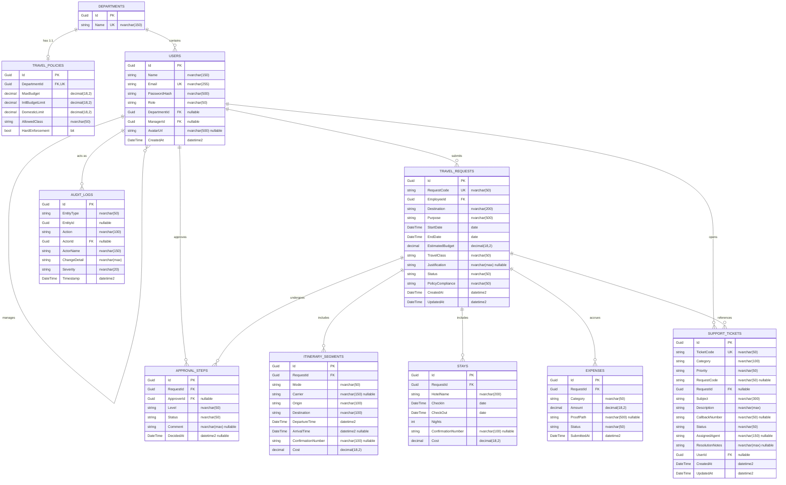

# VoyageHub System Context & Specification

## 1. Overview
VoyageHub is an enterprise corporate travel and expense management application designed to coordinate employee business travel requests, multi-level approvals, expense reimbursements, travel policies, and corporate support desk workflows. The system serves four primary corporate personas: Traveling Employees, Line Managers, Finance Officers, and System Administrators. **[Verified]**

- **Project Type**: Full-Stack Web Application consisting of an ASP.NET Core layered REST API service, an Angular Single Page Application with Server-Side Rendering (SSR), and a relational Microsoft SQL Server database. **[Verified: [Program.cs](file:///c:/Users/rajat/Downloads/Project.NET/VoyageHub-Backend/VoyageHub.Api/Program.cs), [package.json](file:///c:/Users/rajat/Downloads/Project.NET/VoyageHub-Frontend/package.json), [VoyageHub_Schema.sql](file:///c:/Users/rajat/Downloads/Project.NET/VoyageHub_Schema.sql)]**
- **Technology Stack & Versions**:
  - Runtime & Language: .NET 10 (`net10.0`), C# 13 / 14 preview. **[Verified: [VoyageHub.Api.csproj](file:///c:/Users/rajat/Downloads/Project.NET/VoyageHub-Backend/VoyageHub.Api/VoyageHub.Api.csproj#L4)]**
  - Web API Framework: ASP.NET Core 10 (`Microsoft.NET.Sdk.Web`). **[Verified: [VoyageHub.Api.csproj](file:///c:/Users/rajat/Downloads/Project.NET/VoyageHub-Backend/VoyageHub.Api/VoyageHub.Api.csproj#L1)]**
  - ORM & Database Access: Microsoft Entity Framework Core 8.0.11 with SQL Server provider (`Microsoft.EntityFrameworkCore.SqlServer` v8.0.11). **[Verified: [VoyageHub.Data.csproj](file:///c:/Users/rajat/Downloads/Project.NET/VoyageHub-Backend/VoyageHub.Data/VoyageHub.Data.csproj#L10)]**
  - Cryptography / Password Hashing: BCrypt.Net-Next v4.2.0. **[Verified: [VoyageHub.Business.csproj](file:///c:/Users/rajat/Downloads/Project.NET/VoyageHub-Backend/VoyageHub.Business/VoyageHub.Business.csproj#L14)]**
  - API Documentation: Swashbuckle / OpenAPI (`Microsoft.AspNetCore.OpenApi` v10.0.11, `Swashbuckle.AspNetCore` v10.3.1). **[Verified: [VoyageHub.Api.csproj](file:///c:/Users/rajat/Downloads/Project.NET/VoyageHub-Backend/VoyageHub.Api/VoyageHub.Api.csproj#L15-L16)]**
  - Frontend Client: Angular 21 (`@angular/core` v21.2.0), Angular SSR (`@angular/ssr` v21.2.21), Express 5 (`express` v5.1.0), RxJS v7.8.0. **[Verified: [package.json](file:///c:/Users/rajat/Downloads/Project.NET/VoyageHub-Frontend/package.json#L14-L26)]**
  - Frontend Build & Test: Angular CLI v21.2.21, TypeScript v5.9.2, Vitest v4.0.8. **[Verified: [package.json](file:///c:/Users/rajat/Downloads/Project.NET/VoyageHub-Frontend/package.json#L28-L37)]**
  - Database Engine: Microsoft SQL Server (`AngularAuthDb`). **[Verified: [VoyageHub_Schema.sql](file:///c:/Users/rajat/Downloads/Project.NET/VoyageHub_Schema.sql#L6)]**
- **Current Maturity**: **Working Demo / Early Prototype**. Complete end-to-end CRUD, database schema, routing, and workflows exist and compile without errors. However, authentication relies on persona switching and test bypasses rather than issued JWT bearer tokens, analytics return simulated/mock aggregations, and the backend lacks automated tests. **[Verified: [AuthService.cs](file:///c:/Users/rajat/Downloads/Project.NET/VoyageHub-Backend/VoyageHub.Business/Services/AuthService.cs#L54-L57), [AnalyticsService.cs](file:///c:/Users/rajat/Downloads/Project.NET/VoyageHub-Backend/VoyageHub.Business/Services/AnalyticsService.cs#L12-L39)]**

---

## 2. Constitution (Rules the Project Follows)

| Rule | Specification & Convention | Evidence / Source File | Status |
| :--- | :--- | :--- | :--- |
| **Backend Layered Architecture** | Strict 3-tier layering: Presentation (`VoyageHub.Api`), Business logic & DTOs (`VoyageHub.Business`), Data access & EF Core models (`VoyageHub.Data`). | [VoyageHub.slnx](file:///c:/Users/rajat/Downloads/Project.NET/VoyageHub-Backend/VoyageHub.slnx#L1-L5) | Verified |
| **Backend Dependency Direction** | `Api` references `Business` and `Data`; `Business` references `Data`; `Data` has no dependencies on other solution projects. | [VoyageHub.Api.csproj](file:///c:/Users/rajat/Downloads/Project.NET/VoyageHub-Backend/VoyageHub.Api/VoyageHub.Api.csproj#L9-L12), [VoyageHub.Business.csproj](file:///c:/Users/rajat/Downloads/Project.NET/VoyageHub-Backend/VoyageHub.Business/VoyageHub.Business.csproj#L9-L11) | Verified |
| **Data Layer Abstraction** | Generic repository interface `IRepository<T>` extended by specialized repository interfaces (`ITravelRequestRepository`, `IApprovalStepRepository`, etc.) backed by `AppDbContext`. | [IRepository.cs](file:///c:/Users/rajat/Downloads/Project.NET/VoyageHub-Backend/VoyageHub.Data/Repositories/IRepository.cs#L8-L16), [Repository.cs](file:///c:/Users/rajat/Downloads/Project.NET/VoyageHub-Backend/VoyageHub.Data/Repositories/Repository.cs#L9-L49) | Verified |
| **DI Registration Lifetime** | Repositories and business services are registered with `Scoped` lifetime, sharing one `AppDbContext` instance per HTTP request. | [Program.cs](file:///c:/Users/rajat/Downloads/Project.NET/VoyageHub-Backend/VoyageHub.Api/Program.cs#L12-L28) | Verified |
| **Frontend State & Reactivity** | Authentication and session state are managed via Angular Signals (`signal`, `computed`) in `AuthService`. | [auth.service.ts](file:///c:/Users/rajat/Downloads/Project.NET/VoyageHub-Frontend/src/app/services/auth.service.ts#L120-L130) | Verified |
| **Frontend Component Structure** | Standalone components organized by feature module (`admin/`, `analytics/`, `approvals/`, `dashboard/`, `finance/`, `requests/`, `support/`, `settings/`). | [app.routes.ts](file:///c:/Users/rajat/Downloads/Project.NET/VoyageHub-Frontend/src/app/app.routes.ts#L1-L41) | Verified |
| **Route Protection** | Role-based authorization guard `roleGuard(['RoleName'])` guards protected routes on client side. | [role.guard.ts](file:///c:/Users/rajat/Downloads/Project.NET/VoyageHub-Frontend/src/app/guards/role.guard.ts#L6-L16) | Verified |
| **JSON Casing & Serialization** | API responses serialize JSON property names using `CamelCase`. Client TypeScript models strictly mirror backend camelCase DTOs. | [Program.cs](file:///c:/Users/rajat/Downloads/Project.NET/VoyageHub-Backend/VoyageHub.Api/Program.cs#L32-L35), [voyage.service.ts](file:///c:/Users/rajat/Downloads/Project.NET/VoyageHub-Frontend/src/app/services/voyage.service.ts#L5-L100) | Verified |
| **Database Table Naming** | Relational tables and constraints strictly follow uppercase naming conventions (`USERS`, `DEPARTMENTS`, `TRAVEL_REQUESTS`, `APPROVAL_STEPS`, `ITINERARY_SEGMENTS`, `STAYS`, `EXPENSES`, `TRAVEL_POLICIES`, `AUDIT_LOGS`, `SUPPORT_TICKETS`). | [AppDbContext.cs](file:///c:/Users/rajat/Downloads/Project.NET/VoyageHub-Backend/VoyageHub.Data/AppDbContext.cs#L27-L162), [VoyageHub_Schema.sql](file:///c:/Users/rajat/Downloads/Project.NET/VoyageHub_Schema.sql#L10-L19) | Verified |
| **Global Usings Pattern** | Common namespace imports are centralized in `GlobalUsings.cs` in each backend project. | [GlobalUsings.cs](file:///c:/Users/rajat/Downloads/Project.NET/VoyageHub-Backend/VoyageHub.Api/GlobalUsings.cs#L1-L4) | Verified |
| **Async & Cancellation** | Asynchronous service and repository methods accept an optional `CancellationToken` defaulting to `default`. | [ITravelRequestService.cs](file:///c:/Users/rajat/Downloads/Project.NET/VoyageHub-Backend/VoyageHub.Business/Services/ITravelRequestService.cs#L13-L25) | Verified |
| **Audit Logging Pattern** | State-altering actions trigger audit log records inserted into `AUDIT_LOGS` table via `IAuditService.LogAsync()`. | [TravelRequestService.cs](file:///c:/Users/rajat/Downloads/Project.NET/VoyageHub-Backend/VoyageHub.Business/Services/TravelRequestService.cs#L257-L266), [ApprovalService.cs](file:///c:/Users/rajat/Downloads/Project.NET/VoyageHub-Backend/VoyageHub.Business/Services/ApprovalService.cs#L107-L116) | Verified |
| **Intentional Backdoor Shortcut** | `AuthService.ValidateUserCredentials` deliberately bypasses BCrypt hashing for predefined demonstration passwords. | [AuthService.cs](file:///c:/Users/rajat/Downloads/Project.NET/VoyageHub-Backend/VoyageHub.Business/Services/AuthService.cs#L54-L57) | Verified |
| **Intentional Mock Aggregations** | Repositories and services fall back to hardcoded mock numbers when queries return empty results to guarantee rich dashboard UI demos. | [TravelRequestRepository.cs](file:///c:/Users/rajat/Downloads/Project.NET/VoyageHub-Backend/VoyageHub.Data/Repositories/TravelRequestRepository.cs#L83), [ExpenseRepository.cs](file:///c:/Users/rajat/Downloads/Project.NET/VoyageHub-Backend/VoyageHub.Data/Repositories/ExpenseRepository.cs#L41), [AnalyticsService.cs](file:///c:/Users/rajat/Downloads/Project.NET/VoyageHub-Backend/VoyageHub.Business/Services/AnalyticsService.cs#L12-L39) | Verified |

---

## 3. Functional Requirements (As Built)

### Authentication & User Profiles
| ID | Requirement Statement | Status | Source Files | Confidence |
| :--- | :--- | :--- | :--- | :--- |
| **FR-AUTH-01** | The system shall authenticate users with email and password, returning profile information upon success. | Implemented | [AuthController.cs](file:///c:/Users/rajat/Downloads/Project.NET/VoyageHub-Backend/VoyageHub.Api/Controllers/AuthController.cs#L24-L41), [AuthService.cs](file:///c:/Users/rajat/Downloads/Project.NET/VoyageHub-Backend/VoyageHub.Business/Services/AuthService.cs#L23-L87), [auth.service.ts](file:///c:/Users/rajat/Downloads/Project.NET/VoyageHub-Frontend/src/app/services/auth.service.ts#L175-L210) | Verified |
| **FR-AUTH-02** | The system shall permit bypass passwords during credential verification for testing and demonstration workflows. | Implemented | [AuthService.cs](file:///c:/Users/rajat/Downloads/Project.NET/VoyageHub-Backend/VoyageHub.Business/Services/AuthService.cs#L54-L57) | Verified |
| **FR-AUTH-03** | The system shall list pre-seeded user personas for instant demo persona switching in UI. | Implemented | [AuthController.cs](file:///c:/Users/rajat/Downloads/Project.NET/VoyageHub-Backend/VoyageHub.Api/Controllers/AuthController.cs#L43-L48), [auth.service.ts](file:///c:/Users/rajat/Downloads/Project.NET/VoyageHub-Frontend/src/app/services/auth.service.ts#L43-L118) | Verified |
| **FR-AUTH-04** | The system shall update a user's display name and avatar URL while persisting changes to the database. | Partial | [AuthController.cs](file:///c:/Users/rajat/Downloads/Project.NET/VoyageHub-Backend/VoyageHub.Api/Controllers/AuthController.cs#L50-L67), [AuthService.cs](file:///c:/Users/rajat/Downloads/Project.NET/VoyageHub-Backend/VoyageHub.Business/Services/AuthService.cs#L106-L160) | Verified |
| **FR-AUTH-05** | The system shall allow users to change passwords by validating current credentials and writing new BCrypt hashes. | Implemented | [AuthController.cs](file:///c:/Users/rajat/Downloads/Project.NET/VoyageHub-Backend/VoyageHub.Api/Controllers/AuthController.cs#L69-L86), [AuthService.cs](file:///c:/Users/rajat/Downloads/Project.NET/VoyageHub-Backend/VoyageHub.Business/Services/AuthService.cs#L162-L214) | Verified |

### Travel Requests & Workflows
| ID | Requirement Statement | Status | Source Files | Confidence |
| :--- | :--- | :--- | :--- | :--- |
| **FR-TRV-01** | The system shall list travel requests filtered by status, employee ID, and search keyword. | Implemented | [TravelRequestsController.cs](file:///c:/Users/rajat/Downloads/Project.NET/VoyageHub-Backend/VoyageHub.Api/Controllers/TravelRequestsController.cs#L24-L33), [TravelRequestRepository.cs](file:///c:/Users/rajat/Downloads/Project.NET/VoyageHub-Backend/VoyageHub.Data/Repositories/TravelRequestRepository.cs#L17-L64), [request-list.ts](file:///c:/Users/rajat/Downloads/Project.NET/VoyageHub-Frontend/src/app/requests/request-list/request-list.ts) | Verified |
| **FR-TRV-02** | The system shall calculate dashboard KPI metrics (drafts, pending, upcoming trips, pending reimbursement totals). | Implemented | [TravelRequestsController.cs](file:///c:/Users/rajat/Downloads/Project.NET/VoyageHub-Backend/VoyageHub.Api/Controllers/TravelRequestsController.cs#L35-L40), [TravelRequestService.cs](file:///c:/Users/rajat/Downloads/Project.NET/VoyageHub-Backend/VoyageHub.Business/Services/TravelRequestService.cs#L62-L73), [dashboard.ts](file:///c:/Users/rajat/Downloads/Project.NET/VoyageHub-Frontend/src/app/dashboard/dashboard.ts) | Verified |
| **FR-TRV-03** | The system shall retrieve full travel request details including itineraries, stays, expenses, and approval steps. | Implemented | [TravelRequestsController.cs](file:///c:/Users/rajat/Downloads/Project.NET/VoyageHub-Backend/VoyageHub.Api/Controllers/TravelRequestsController.cs#L42-L48), [TravelRequestService.cs](file:///c:/Users/rajat/Downloads/Project.NET/VoyageHub-Backend/VoyageHub.Business/Services/TravelRequestService.cs#L75-L150), [request-detail.ts](file:///c:/Users/rajat/Downloads/Project.NET/VoyageHub-Frontend/src/app/requests/request-detail/request-detail.ts) | Verified |
| **FR-TRV-04** | The system shall create travel requests as Draft or In Review, auto-checking budget limits against department policies. | Implemented | [TravelRequestsController.cs](file:///c:/Users/rajat/Downloads/Project.NET/VoyageHub-Backend/VoyageHub.Api/Controllers/TravelRequestsController.cs#L50-L59), [TravelRequestService.cs](file:///c:/Users/rajat/Downloads/Project.NET/VoyageHub-Backend/VoyageHub.Business/Services/TravelRequestService.cs#L152-L280), [new-request.ts](file:///c:/Users/rajat/Downloads/Project.NET/VoyageHub-Frontend/src/app/requests/new-request/new-request.ts) | Verified |
| **FR-TRV-05** | The system shall submit draft travel requests into "Manager Review" and instantiate sequential approval steps. | Implemented | [TravelRequestsController.cs](file:///c:/Users/rajat/Downloads/Project.NET/VoyageHub-Backend/VoyageHub.Api/Controllers/TravelRequestsController.cs#L69-L74), [TravelRequestService.cs](file:///c:/Users/rajat/Downloads/Project.NET/VoyageHub-Backend/VoyageHub.Business/Services/TravelRequestService.cs#L304-L357) | Verified |
| **FR-TRV-06** | The system shall permit cancelling active travel requests and record an audit log event. | Implemented | [TravelRequestsController.cs](file:///c:/Users/rajat/Downloads/Project.NET/VoyageHub-Backend/VoyageHub.Api/Controllers/TravelRequestsController.cs#L61-L67), [TravelRequestService.cs](file:///c:/Users/rajat/Downloads/Project.NET/VoyageHub-Backend/VoyageHub.Business/Services/TravelRequestService.cs#L282-L302) | Verified |
| **FR-TRV-07** | The system shall add itinerary segments and hotel stay reservations to existing travel requests. | Implemented | [TravelRequestsController.cs](file:///c:/Users/rajat/Downloads/Project.NET/VoyageHub-Backend/VoyageHub.Api/Controllers/TravelRequestsController.cs#L76-L91), [TravelRequestService.cs](file:///c:/Users/rajat/Downloads/Project.NET/VoyageHub-Backend/VoyageHub.Business/Services/TravelRequestService.cs#L359-L411) | Verified |
| **FR-TRV-08** | The system shall close completed travel requests, transitioning status to "Completed". | Implemented | [TravelRequestsController.cs](file:///c:/Users/rajat/Downloads/Project.NET/VoyageHub-Backend/VoyageHub.Api/Controllers/TravelRequestsController.cs#L92-L98), [TravelRequestService.cs](file:///c:/Users/rajat/Downloads/Project.NET/VoyageHub-Backend/VoyageHub.Business/Services/TravelRequestService.cs#L413-L433) | Verified |

### Approvals & Escalations
| ID | Requirement Statement | Status | Source Files | Confidence |
| :--- | :--- | :--- | :--- | :--- |
| **FR-APPR-01** | The system shall display approval queue items filtered by approver ID or role (Manager / Finance). | Implemented | [ApprovalsController.cs](file:///c:/Users/rajat/Downloads/Project.NET/VoyageHub-Backend/VoyageHub.Api/Controllers/ApprovalsController.cs#L21-L29), [ApprovalService.cs](file:///c:/Users/rajat/Downloads/Project.NET/VoyageHub-Backend/VoyageHub.Business/Services/ApprovalService.cs#L23-L53), [approval-queue.ts](file:///c:/Users/rajat/Downloads/Project.NET/VoyageHub-Frontend/src/app/approvals/approval-queue/approval-queue.ts) | Verified |
| **FR-APPR-02** | The system shall process approval decisions: advancing Manager approval to Finance Review, finalizing Finance approval to Approved, or rejecting requests and cancelling remaining steps. | Implemented | [ApprovalsController.cs](file:///c:/Users/rajat/Downloads/Project.NET/VoyageHub-Backend/VoyageHub.Api/Controllers/ApprovalsController.cs#L31-L41), [ApprovalService.cs](file:///c:/Users/rajat/Downloads/Project.NET/VoyageHub-Backend/VoyageHub.Business/Services/ApprovalService.cs#L55-L121) | Verified |

### Expenses & Reimbursements
| ID | Requirement Statement | Status | Source Files | Confidence |
| :--- | :--- | :--- | :--- | :--- |
| **FR-EXP-01** | The system shall retrieve pending expense claims filtered by category and high-priority amounts (>= 10,000 INR). | Implemented | [ExpensesController.cs](file:///c:/Users/rajat/Downloads/Project.NET/VoyageHub-Backend/VoyageHub.Api/Controllers/ExpensesController.cs#L22-L30), [ExpenseService.cs](file:///c:/Users/rajat/Downloads/Project.NET/VoyageHub-Backend/VoyageHub.Business/Services/ExpenseService.cs#L23-L48), [expense-review.ts](file:///c:/Users/rajat/Downloads/Project.NET/VoyageHub-Frontend/src/app/finance/expense-review/expense-review.ts) | Verified |
| **FR-EXP-02** | The system shall submit expense claims attached to a travel request, assigning a dummy proof path if no receipt file is uploaded. | Implemented | [ExpensesController.cs](file:///c:/Users/rajat/Downloads/Project.NET/VoyageHub-Backend/VoyageHub.Api/Controllers/ExpensesController.cs#L32-L42), [ExpenseService.cs](file:///c:/Users/rajat/Downloads/Project.NET/VoyageHub-Backend/VoyageHub.Business/Services/ExpenseService.cs#L50-L83) | Verified |
| **FR-EXP-03** | The system shall approve ("Reimbursed") or reject ("Rejected") individual expense claims with audit trail attribution. | Implemented | [ExpensesController.cs](file:///c:/Users/rajat/Downloads/Project.NET/VoyageHub-Backend/VoyageHub.Api/Controllers/ExpensesController.cs#L44-L54), [ExpenseService.cs](file:///c:/Users/rajat/Downloads/Project.NET/VoyageHub-Backend/VoyageHub.Business/Services/ExpenseService.cs#L85-L109) | Verified |
| **FR-EXP-04** | The system shall process batch reimbursement payouts for multiple selected pending expense claims. | Implemented | [ExpensesController.cs](file:///c:/Users/rajat/Downloads/Project.NET/VoyageHub-Backend/VoyageHub.Api/Controllers/ExpensesController.cs#L56-L61), [ExpenseService.cs](file:///c:/Users/rajat/Downloads/Project.NET/VoyageHub-Backend/VoyageHub.Business/Services/ExpenseService.cs#L111-L133) | Verified |

### Travel Policies & Administration
| ID | Requirement Statement | Status | Source Files | Confidence |
| :--- | :--- | :--- | :--- | :--- |
| **FR-POL-01** | The system shall retrieve all department travel policies with budget limits and allowed travel classes. | Implemented | [PoliciesController.cs](file:///c:/Users/rajat/Downloads/Project.NET/VoyageHub-Backend/VoyageHub.Api/Controllers/PoliciesController.cs#L22-L27), [PolicyService.cs](file:///c:/Users/rajat/Downloads/Project.NET/VoyageHub-Backend/VoyageHub.Business/Services/PolicyService.cs#L23-L37), [policy-config.ts](file:///c:/Users/rajat/Downloads/Project.NET/VoyageHub-Frontend/src/app/admin/policy-config/policy-config.ts) | Verified |
| **FR-POL-02** | The system shall update policy limits, flight classes, and enforcement parameters for an existing policy ID. | Implemented | [PoliciesController.cs](file:///c:/Users/rajat/Downloads/Project.NET/VoyageHub-Backend/VoyageHub.Api/Controllers/PoliciesController.cs#L29-L39), [PolicyService.cs](file:///c:/Users/rajat/Downloads/Project.NET/VoyageHub-Backend/VoyageHub.Business/Services/PolicyService.cs#L39-L65) | Verified |
| **FR-POL-03** | The system shall create travel policies for departments, preventing duplicate policies per department. | Implemented | [PoliciesController.cs](file:///c:/Users/rajat/Downloads/Project.NET/VoyageHub-Backend/VoyageHub.Api/Controllers/PoliciesController.cs#L41-L51), [PolicyService.cs](file:///c:/Users/rajat/Downloads/Project.NET/VoyageHub-Backend/VoyageHub.Business/Services/PolicyService.cs#L67-L123) | Verified |
| **FR-POL-04** | The system shall delete a department travel policy by ID while preserving the department record. | Implemented | [PoliciesController.cs](file:///c:/Users/rajat/Downloads/Project.NET/VoyageHub-Backend/VoyageHub.Api/Controllers/PoliciesController.cs#L53-L63), [PolicyService.cs](file:///c:/Users/rajat/Downloads/Project.NET/VoyageHub-Backend/VoyageHub.Business/Services/PolicyService.cs#L125-L147) | Verified |

### Support Desk & Audit Logging
| ID | Requirement Statement | Status | Source Files | Confidence |
| :--- | :--- | :--- | :--- | :--- |
| **FR-SUP-01** | The system shall list support tickets filtered by status, user ID, or search query. | Implemented | [SupportController.cs](file:///c:/Users/rajat/Downloads/Project.NET/VoyageHub-Backend/VoyageHub.Api/Controllers/SupportController.cs#L24-L41), [SupportService.cs](file:///c:/Users/rajat/Downloads/Project.NET/VoyageHub-Backend/VoyageHub.Business/Services/SupportService.cs#L23-L46), [support.ts](file:///c:/Users/rajat/Downloads/Project.NET/VoyageHub-Frontend/src/app/support/support.ts) | Verified |
| **FR-SUP-02** | The system shall create support tickets with generated codes (`#TICK-xxxx`), linking optional travel requests, and auto-assigning default support desk agents. | Implemented | [SupportController.cs](file:///c:/Users/rajat/Downloads/Project.NET/VoyageHub-Backend/VoyageHub.Api/Controllers/SupportController.cs#L63-L81), [SupportService.cs](file:///c:/Users/rajat/Downloads/Project.NET/VoyageHub-Backend/VoyageHub.Business/Services/SupportService.cs#L74-L160) | Verified |
| **FR-SUP-03** | The system shall update ticket resolution status, notes, and assigned agents. | Implemented | [SupportController.cs](file:///c:/Users/rajat/Downloads/Project.NET/VoyageHub-Backend/VoyageHub.Api/Controllers/SupportController.cs#L83-L101), [SupportService.cs](file:///c:/Users/rajat/Downloads/Project.NET/VoyageHub-Backend/VoyageHub.Business/Services/SupportService.cs#L162-L196) | Verified |
| **FR-AUD-01** | The system shall retrieve audit trail logs filtered by severity and entity type. | Implemented | [AuditLogsController.cs](file:///c:/Users/rajat/Downloads/Project.NET/VoyageHub-Backend/VoyageHub.Api/Controllers/AuditLogsController.cs#L21-L30), [AuditService.cs](file:///c:/Users/rajat/Downloads/Project.NET/VoyageHub-Backend/VoyageHub.Business/Services/AuditService.cs#L21-L36), [audit-logs.ts](file:///c:/Users/rajat/Downloads/Project.NET/VoyageHub-Frontend/src/app/admin/audit-logs/audit-logs.ts) | Verified |
| **FR-ANL-01** | The system shall provide high-level spend analytics, category breakdown, and monthly trends. | Stubbed | [AnalyticsController.cs](file:///c:/Users/rajat/Downloads/Project.NET/VoyageHub-Backend/VoyageHub.Api/Controllers/AnalyticsController.cs#L20-L25), [AnalyticsService.cs](file:///c:/Users/rajat/Downloads/Project.NET/VoyageHub-Backend/VoyageHub.Business/Services/AnalyticsService.cs#L10-L42), [analytics-reports.ts](file:///c:/Users/rajat/Downloads/Project.NET/VoyageHub-Frontend/src/app/analytics/analytics-reports/analytics-reports.ts) | Verified |

---

## 4. Acceptance Criteria

- **FR-AUTH-01 / FR-AUTH-02**:
  - `Given` a user email existing in `USERS` table and a recognized bypass password,
  - `When` a POST request is sent to `/api/Auth/login`,
  - `Then` the system shall return HTTP 200 with `Success = true`, the user profile, and message `"Welcome back, <Name>!"`. **[Verified: [AuthService.cs](file:///c:/Users/rajat/Downloads/Project.NET/VoyageHub-Backend/VoyageHub.Business/Services/AuthService.cs#L54-L86)]**
- **FR-AUTH-01**:
  - `Given` empty or whitespace strings for email or password,
  - `When` a POST request is sent to `/api/Auth/login`,
  - `Then` the system shall return HTTP 400 with `Success = false` and message `"Email and password are required."`. **[Verified: [AuthService.cs](file:///c:/Users/rajat/Downloads/Project.NET/VoyageHub-Backend/VoyageHub.Business/Services/AuthService.cs#L25-L32)]**
- **FR-AUTH-04**:
  - `Given` a valid user GUID and an update payload with `Fullname`, `AvatarUrl`, and extended preferences (`SeatPreference`, `MealPreference`),
  - `When` a PUT request is sent to `/api/Auth/profile`,
  - `Then` the system shall persist only `Name` and `AvatarUrl` in `USERS`, record a `LOW` severity audit log under entity `ACCESS`, and return HTTP 200 with the updated profile. **[Verified: [AuthService.cs](file:///c:/Users/rajat/Downloads/Project.NET/VoyageHub-Backend/VoyageHub.Business/Services/AuthService.cs#L119-L160)]**
- **FR-TRV-04**:
  - `Given` an employee whose department policy sets `IntlBudgetLimit = 3000.00`, and a new request payload with `EstimatedBudget = 5000.00` and `SaveAsDraft = false`,
  - `When` a POST request is sent to `/api/TravelRequests`,
  - `Then` the request is created with `Status = "In Review"`, `PolicyCompliance = "Flagged"`, auto-generated RequestCode matching `#TR-{2050 + count + 1}`, and linked ApprovalSteps for Manager and Finance. **[Verified: [TravelRequestService.cs](file:///c:/Users/rajat/Downloads/Project.NET/VoyageHub-Backend/VoyageHub.Business/Services/TravelRequestService.cs#L167-L253)]**
- **FR-TRV-05**:
  - `Given` a travel request with `Status = "Draft"`,
  - `When` a POST request is sent to `/api/TravelRequests/{id}/submit`,
  - `Then` previous approval steps are removed, `Status` transitions to `"Manager Review"`, a `Manager` approval step is set to `"Pending"`, and a `Finance` step is set to `"Waiting"`. **[Verified: [TravelRequestService.cs](file:///c:/Users/rajat/Downloads/Project.NET/VoyageHub-Backend/VoyageHub.Business/Services/TravelRequestService.cs#L309-L343)]**
- **FR-TRV-05**:
  - `Given` a travel request with `Status != "Draft"`,
  - `When` a POST request is sent to `/api/TravelRequests/{id}/submit`,
  - `Then` the system returns HTTP 400 with message `"Only Draft requests can be submitted."`. **[Verified: [TravelRequestService.cs](file:///c:/Users/rajat/Downloads/Project.NET/VoyageHub-Backend/VoyageHub.Business/Services/TravelRequestService.cs#L309)]**
- **FR-APPR-02**:
  - `Given` an approval step with `Level = "Manager"` and `Status = "Pending"`,
  - `When` an action payload `{ "action": "Approve", "comment": "Approved" }` is posted to `/api/Approvals/{stepId}/action`,
  - `Then` the step transitions to `"Approved"`, the travel request status becomes `"Finance Review"`, the existing Finance step transitions to `"Pending"`, and an audit log with entity type `APPROVAL` is created. **[Verified: [ApprovalService.cs](file:///c:/Users/rajat/Downloads/Project.NET/VoyageHub-Backend/VoyageHub.Business/Services/ApprovalService.cs#L63-L85)]**
- **FR-APPR-02**:
  - `Given` an approval step with `Status = "Pending"`,
  - `When` an action payload `{ "action": "Reject", "comment": "Budget exceeded" }` is posted to `/api/Approvals/{stepId}/action`,
  - `Then` the step transitions to `"Rejected"`, the travel request status becomes `"Rejected"`, and all other non-approved steps for that request are marked `"Cancelled"`. **[Verified: [ApprovalService.cs](file:///c:/Users/rajat/Downloads/Project.NET/VoyageHub-Backend/VoyageHub.Business/Services/ApprovalService.cs#L95-L104)]**
- **FR-EXP-03**:
  - `Given` a pending expense claim GUID,
  - `When` a POST request is sent to `/api/Expenses/{id}/action` with `{ "action": "Approve" }`,
  - `Then` the expense `Status` is updated to `"Reimbursed"`, an audit record attributed to `"Vikram Malhotra (Finance)"` is saved, and HTTP 200 with `{ "success": true, "message": "Expense claim reimbursed." }` is returned. **[Verified: [ExpenseService.cs](file:///c:/Users/rajat/Downloads/Project.NET/VoyageHub-Backend/VoyageHub.Business/Services/ExpenseService.cs#L85-L109)]**
- **FR-EXP-04**:
  - `Given` a list of pending expense GUIDs in `BatchPayoutDto.ExpenseIds`,
  - `When` a POST request is sent to `/api/Expenses/batch-payout`,
  - `Then` each matching pending expense status is changed to `"Reimbursed"` and an audit log is created recording the count and total reimbursement amount. **[Verified: [ExpenseService.cs](file:///c:/Users/rajat/Downloads/Project.NET/VoyageHub-Backend/VoyageHub.Business/Services/ExpenseService.cs#L111-L133)]**
- **FR-POL-03**:
  - `Given` a `CreatePolicyDto` with a `DepartmentName` that already possesses a travel policy in the database,
  - `When` a POST request is sent to `/api/Policies`,
  - `Then` the system shall abort creation and return HTTP 400 with message `"A policy already exists for this department."`. **[Verified: [PolicyService.cs](file:///c:/Users/rajat/Downloads/Project.NET/VoyageHub-Backend/VoyageHub.Business/Services/PolicyService.cs#L83-L86)]**
- **FR-SUP-02**:
  - `Given` a `CreateSupportTicketDto` with `Subject` and `Description`,
  - `When` a POST request is sent to `/api/Support/tickets`,
  - `Then` the system generates a ticket code matching `#TICK-{1000..9999}`, assigns agent `"Meera Sen (Corporate Travel Desk)"`, sets status `"Open"`, records an audit log, and returns HTTP 200 with the created ticket DTO. **[Verified: [SupportService.cs](file:///c:/Users/rajat/Downloads/Project.NET/VoyageHub-Backend/VoyageHub.Business/Services/SupportService.cs#L74-L160)]**

---

## 5. Non-Functional Requirements (As Built)

| Dimension | What Exists in Code | What Is Absent / Missing | Confidence |
| :--- | :--- | :--- | :--- |
| **Authentication & Sessions** | Single login endpoint `/api/Auth/login` returning user profile; BCrypt hash validation. Client saves persona to local storage / memory. | **Absent**: JWT token generation, session cookies, bearer token validation, refresh tokens. No `builder.Services.AddAuthentication()` configured. **[Verified: [Program.cs](file:///c:/Users/rajat/Downloads/Project.NET/VoyageHub-Backend/VoyageHub.Api/Program.cs#L6-L65)]** | Verified |
| **Authorization & Access Control** | `app.UseAuthorization()` is invoked in ASP.NET Core middleware. Client-side Angular `roleGuard` enforces view access. | **Absent**: `[Authorize]` or role attribute filters on backend controllers. Any unauthenticated HTTP client can invoke all endpoints directly. | Verified |
| **Input Validation** | Ad-hoc null and empty string checks in service methods; EF Core `MaxLength` attributes on models. | **Absent**: FluentValidation, DataAnnotation validation filters, validation of dates (`StartDate <= EndDate`), budget limits (`> 0`). | Verified |
| **CSRF & Injection Protection** | EF Core parameterized SQL queries via LINQ prevent SQL injection on database operations. | **Absent**: Antiforgery tokens (CSRF) for state-changing endpoints (relies entirely on CORS preflight). | Verified |
| **CORS Policy** | Explicit CORS policy `"AllowAngularApp"` permitting `http://localhost:4200`, `http://127.0.0.1:4200`, `https://localhost:4200` with credentials, any header, and any method. | **Absent**: Configurable production origin lists via `appsettings.json`. | Verified |
| **Performance & Caching** | Read queries leverage `.AsNoTracking()` across repositories (`TravelRequestRepository`, `ApprovalStepRepository`, `AuditLogRepository`, `PolicyRepository`, `SupportTicketRepository`). | **Absent**: Output caching, in-memory caching (`IMemoryCache`), Redis distributed caching, or pagination metadata tokens. | Verified |
| **Accessibility (a11y)** | Semantic HTML structure, input labels, and SVG iconography in UI templates. | **Absent**: ARIA live regions for status notifications, automated axe-core a11y tests. | Inferred |
| **Error Handling** | Local `try-catch` blocks returning HTTP 500 in `AuthController` and `SupportController`. Custom response tuples `(bool Success, string Message)`. | **Absent**: Global exception handling middleware or ProblemDetails exception mapping. | Verified |
| **Logging** | `ILogger<T>` injected into API controllers; custom business audit trail saved to `AUDIT_LOGS` table. | **Absent**: Structured Serilog / NLog configuration, file log sinks, correlation IDs across requests, or external telemetry (Application Insights / OpenTelemetry). | Verified |
| **Configuration** | Database connection string configured via `ConnectionStrings:DefaultConnection` in `appsettings.json`. Clean template in `appsettings.example.json`. | **Absent**: Strongly typed options (`IOptions<T>`), Azure Key Vault or User Secrets integration. | Verified |

---

## 6. Data Model and Contracts

### Entity Relational Model



### Public API Endpoints Contract

| Method | Route Path | Query / Route Params | Request Body | Response Output | Source File |
| :--- | :--- | :--- | :--- | :--- | :--- |
| **GET** | `/` | None | None | 302 Redirect to `/swagger` | [Program.cs](file:///c:/Users/rajat/Downloads/Project.NET/VoyageHub-Backend/VoyageHub.Api/Program.cs#L78) |
| **POST** | `/api/Auth/login` | None | `LoginDto` | `AuthResponseDto` | [AuthController.cs](file:///c:/Users/rajat/Downloads/Project.NET/VoyageHub-Backend/VoyageHub.Api/Controllers/AuthController.cs#L24-L41) |
| **GET** | `/api/Auth/personas` | None | None | `List<UserProfileDto>` | [AuthController.cs](file:///c:/Users/rajat/Downloads/Project.NET/VoyageHub-Backend/VoyageHub.Api/Controllers/AuthController.cs#L43-L48) |
| **PUT** | `/api/Auth/profile` | None | `UpdateProfileDto` | `AuthResponseDto` | [AuthController.cs](file:///c:/Users/rajat/Downloads/Project.NET/VoyageHub-Backend/VoyageHub.Api/Controllers/AuthController.cs#L50-L67) |
| **POST** | `/api/Auth/change-password` | None | `ChangePasswordDto` | `AuthResponseDto` | [AuthController.cs](file:///c:/Users/rajat/Downloads/Project.NET/VoyageHub-Backend/VoyageHub.Api/Controllers/AuthController.cs#L69-L86) |
| **GET** | `/api/TravelRequests` | `status`, `search`, `employeeId`, `limit` | None | `List<TravelRequestListDto>` | [TravelRequestsController.cs](file:///c:/Users/rajat/Downloads/Project.NET/VoyageHub-Backend/VoyageHub.Api/Controllers/TravelRequestsController.cs#L24-L33) |
| **GET** | `/api/TravelRequests/stats` | `employeeId` | None | `DashboardStatsDto` | [TravelRequestsController.cs](file:///c:/Users/rajat/Downloads/Project.NET/VoyageHub-Backend/VoyageHub.Api/Controllers/TravelRequestsController.cs#L35-L40) |
| **GET** | `/api/TravelRequests/{id}` | `id` (Guid) | None | `TravelRequestDetailDto` | [TravelRequestsController.cs](file:///c:/Users/rajat/Downloads/Project.NET/VoyageHub-Backend/VoyageHub.Api/Controllers/TravelRequestsController.cs#L42-L48) |
| **POST** | `/api/TravelRequests` | `employeeId` (Guid?) | `CreateTravelRequestDto` | `TravelRequestDetailDto` | [TravelRequestsController.cs](file:///c:/Users/rajat/Downloads/Project.NET/VoyageHub-Backend/VoyageHub.Api/Controllers/TravelRequestsController.cs#L50-L59) |
| **DELETE**| `/api/TravelRequests/{id}` | `id` (Guid) | None | `{ message: string }` | [TravelRequestsController.cs](file:///c:/Users/rajat/Downloads/Project.NET/VoyageHub-Backend/VoyageHub.Api/Controllers/TravelRequestsController.cs#L61-L67) |
| **POST** | `/api/TravelRequests/{id}/submit` | `id` (Guid) | None | `{ success: bool, message: string }` | [TravelRequestsController.cs](file:///c:/Users/rajat/Downloads/Project.NET/VoyageHub-Backend/VoyageHub.Api/Controllers/TravelRequestsController.cs#L69-L74) |
| **POST** | `/api/TravelRequests/{id}/segments` | `id` (Guid) | `AddSegmentDto` | `ItinerarySegment` | [TravelRequestsController.cs](file:///c:/Users/rajat/Downloads/Project.NET/VoyageHub-Backend/VoyageHub.Api/Controllers/TravelRequestsController.cs#L76-L82) |
| **POST** | `/api/TravelRequests/{id}/stays` | `id` (Guid) | `AddStayDto` | `Stay` | [TravelRequestsController.cs](file:///c:/Users/rajat/Downloads/Project.NET/VoyageHub-Backend/VoyageHub.Api/Controllers/TravelRequestsController.cs#L84-L90) |
| **POST** | `/api/TravelRequests/{id}/close` | `id` (Guid) | None | `{ success: bool, message: string }` | [TravelRequestsController.cs](file:///c:/Users/rajat/Downloads/Project.NET/VoyageHub-Backend/VoyageHub.Api/Controllers/TravelRequestsController.cs#L92-L98) |
| **GET** | `/api/Approvals/queue` | `approverId`, `role` | None | `ApprovalQueueSummaryDto` | [ApprovalsController.cs](file:///c:/Users/rajat/Downloads/Project.NET/VoyageHub-Backend/VoyageHub.Api/Controllers/ApprovalsController.cs#L21-L29) |
| **POST** | `/api/Approvals/{stepId}/action` | `stepId` (Guid) | `ApprovalActionDto` | `{ success: bool, message: string }` | [ApprovalsController.cs](file:///c:/Users/rajat/Downloads/Project.NET/VoyageHub-Backend/VoyageHub.Api/Controllers/ApprovalsController.cs#L31-L41) |
| **GET** | `/api/Expenses/pending` | `category`, `highPriorityOnly` | None | `ExpenseReviewSummaryDto` | [ExpensesController.cs](file:///c:/Users/rajat/Downloads/Project.NET/VoyageHub-Backend/VoyageHub.Api/Controllers/ExpensesController.cs#L22-L30) |
| **POST** | `/api/Expenses` | None | `SubmitExpenseDto` | `Expense` | [ExpensesController.cs](file:///c:/Users/rajat/Downloads/Project.NET/VoyageHub-Backend/VoyageHub.Api/Controllers/ExpensesController.cs#L32-L42) |
| **POST** | `/api/Expenses/{id}/action` | `id` (Guid) | `ExpenseActionDto` | `{ success: bool, message: string }` | [ExpensesController.cs](file:///c:/Users/rajat/Downloads/Project.NET/VoyageHub-Backend/VoyageHub.Api/Controllers/ExpensesController.cs#L44-L54) |
| **POST** | `/api/Expenses/batch-payout` | None | `BatchPayoutDto?` | `{ success: bool, message: string }` | [ExpensesController.cs](file:///c:/Users/rajat/Downloads/Project.NET/VoyageHub-Backend/VoyageHub.Api/Controllers/ExpensesController.cs#L56-L61) |
| **GET** | `/api/Policies` | None | None | `List<PolicyConfigDto>` | [PoliciesController.cs](file:///c:/Users/rajat/Downloads/Project.NET/VoyageHub-Backend/VoyageHub.Api/Controllers/PoliciesController.cs#L22-L27) |
| **POST** | `/api/Policies` | None | `CreatePolicyDto` | `PolicyConfigDto` | [PoliciesController.cs](file:///c:/Users/rajat/Downloads/Project.NET/VoyageHub-Backend/VoyageHub.Api/Controllers/PoliciesController.cs#L41-L51) |
| **PUT** | `/api/Policies/{id}` | `id` (Guid) | `UpdatePolicyDto` | `{ success: bool, message: string }` | [PoliciesController.cs](file:///c:/Users/rajat/Downloads/Project.NET/VoyageHub-Backend/VoyageHub.Api/Controllers/PoliciesController.cs#L29-L39) |
| **DELETE**| `/api/Policies/{id}` | `id` (Guid) | None | `{ success: bool, message: string }` | [PoliciesController.cs](file:///c:/Users/rajat/Downloads/Project.NET/VoyageHub-Backend/VoyageHub.Api/Controllers/PoliciesController.cs#L53-L63) |
| **GET** | `/api/Support/tickets` | `status`, `userId`, `search` | None | `List<SupportTicketDto>` | [SupportController.cs](file:///c:/Users/rajat/Downloads/Project.NET/VoyageHub-Backend/VoyageHub.Api/Controllers/SupportController.cs#L24-L41) |
| **GET** | `/api/Support/tickets/{id}` | `id` (Guid) | None | `SupportTicketDto` | [SupportController.cs](file:///c:/Users/rajat/Downloads/Project.NET/VoyageHub-Backend/VoyageHub.Api/Controllers/SupportController.cs#L43-L61) |
| **POST** | `/api/Support/tickets` | None | `CreateSupportTicketDto` | `SupportTicketDto` | [SupportController.cs](file:///c:/Users/rajat/Downloads/Project.NET/VoyageHub-Backend/VoyageHub.Api/Controllers/SupportController.cs#L63-L81) |
| **POST** | `/api/Support/tickets/{id}/status` | `id` (Guid) | `UpdateTicketStatusDto` | `{ success: bool, message: string }` | [SupportController.cs](file:///c:/Users/rajat/Downloads/Project.NET/VoyageHub-Backend/VoyageHub.Api/Controllers/SupportController.cs#L83-L101) |
| **GET** | `/api/Analytics/overview` | None | None | `AnalyticsOverviewDto` | [AnalyticsController.cs](file:///c:/Users/rajat/Downloads/Project.NET/VoyageHub-Backend/VoyageHub.Api/Controllers/AnalyticsController.cs#L20-L25) |
| **GET** | `/api/AuditLogs` | `severity`, `entityType`, `limit` | None | `List<AuditLogDto>` | [AuditLogsController.cs](file:///c:/Users/rajat/Downloads/Project.NET/VoyageHub-Backend/VoyageHub.Api/Controllers/AuditLogsController.cs#L21-L30) |

### Frontend Client Routing Contracts

| Route Path | Component | Guard / Access Restriction | Source File |
| :--- | :--- | :--- | :--- |
| `/login` | `Login` | Public | [app.routes.ts](file:///c:/Users/rajat/Downloads/Project.NET/VoyageHub-Frontend/src/app/app.routes.ts#L20) |
| `/reset-password` | `ResetPassword` | Public | [app.routes.ts](file:///c:/Users/rajat/Downloads/Project.NET/VoyageHub-Frontend/src/app/app.routes.ts#L22) |
| `/dashboard` | `Dashboard` | `roleGuard(['Employee', 'Manager', 'Finance', 'Admin'])` | [app.routes.ts](file:///c:/Users/rajat/Downloads/Project.NET/VoyageHub-Frontend/src/app/app.routes.ts#L27) |
| `/requests` | `RequestList` | `roleGuard(['Employee', 'Manager', 'Admin'])` | [app.routes.ts](file:///c:/Users/rajat/Downloads/Project.NET/VoyageHub-Frontend/src/app/app.routes.ts#L28) |
| `/requests/new` | `NewRequest` | `roleGuard(['Employee', 'Manager', 'Admin'])` | [app.routes.ts](file:///c:/Users/rajat/Downloads/Project.NET/VoyageHub-Frontend/src/app/app.routes.ts#L29) |
| `/requests/:id` | `RequestDetail` | `roleGuard(['Employee', 'Manager', 'Finance', 'Admin'])` | [app.routes.ts](file:///c:/Users/rajat/Downloads/Project.NET/VoyageHub-Frontend/src/app/app.routes.ts#L30) |
| `/approvals` | `ApprovalQueue` | `roleGuard(['Manager', 'Finance', 'Admin'])` | [app.routes.ts](file:///c:/Users/rajat/Downloads/Project.NET/VoyageHub-Frontend/src/app/app.routes.ts#L31) |
| `/expenses` | `ExpenseReview` | `roleGuard(['Finance', 'Admin'])` | [app.routes.ts](file:///c:/Users/rajat/Downloads/Project.NET/VoyageHub-Frontend/src/app/app.routes.ts#L32) |
| `/analytics` | `AnalyticsReports`| `roleGuard(['Manager', 'Finance', 'Admin'])` | [app.routes.ts](file:///c:/Users/rajat/Downloads/Project.NET/VoyageHub-Frontend/src/app/app.routes.ts#L33) |
| `/policies` | `PolicyConfigComponent` | `roleGuard(['Admin'])` | [app.routes.ts](file:///c:/Users/rajat/Downloads/Project.NET/VoyageHub-Frontend/src/app/app.routes.ts#L34) |
| `/audit` | `AuditLogs` | `roleGuard(['Admin'])` | [app.routes.ts](file:///c:/Users/rajat/Downloads/Project.NET/VoyageHub-Frontend/src/app/app.routes.ts#L35) |
| `/settings` | `Settings` | `roleGuard(['Employee', 'Manager', 'Finance', 'Admin'])` | [app.routes.ts](file:///c:/Users/rajat/Downloads/Project.NET/VoyageHub-Frontend/src/app/app.routes.ts#L36) |
| `/support` | `Support` | `roleGuard(['Employee', 'Manager', 'Finance', 'Admin'])` | [app.routes.ts](file:///c:/Users/rajat/Downloads/Project.NET/VoyageHub-Frontend/src/app/app.routes.ts#L37) |

---

## 7. Architecture and Plan

### Architecture Diagram

```mermaid
flowchart TD
    subgraph ClientTier ["Frontend Client (Angular 21 + SSR)"]
        Browser["User Browser"]
        NodeSSR["Express SSR Server (Port 4200)"]
        Services["Angular Services (AuthService, VoyageService)"]
        Browser --> NodeSSR
        Browser --> Services
    end

    subgraph ApiTier ["Backend Presentation (VoyageHub.Api)"]
        Controllers["Controllers (Auth, TravelRequests, Approvals, Expenses, Policies, Support, Audit, Analytics)"]
        Swagger["OpenAPI / Swagger UI (Port 5062)"]
    end

    subgraph BusinessTier ["Business Core (VoyageHub.Business)"]
        S_Auth["AuthService"]
        S_Travel["TravelRequestService"]
        S_Approval["ApprovalService"]
        S_Expense["ExpenseService"]
        S_Policy["PolicyService"]
        S_Support["SupportService"]
        S_Audit["AuditService"]
        S_Analytics["AnalyticsService"]
    end

    subgraph DataTier ["Data Persistence (VoyageHub.Data)"]
        Repos["Specialized Repositories"]
        GenRepo["Repository&lt;T&gt;"]
        DbContext["AppDbContext (EF Core 8)"]
    end

    subgraph StorageTier ["Database Engine"]
        SqlServer[("Microsoft SQL Server (AngularAuthDb)")]
    end

    Services -->|HTTP / JSON (REST)| Controllers
    Controllers --> BusinessTier
    S_Auth --> S_Audit
    S_Travel --> S_Audit
    S_Approval --> S_Audit
    S_Expense --> S_Audit
    S_Policy --> S_Audit
    S_Support --> S_Audit
    BusinessTier --> Repos
    Repos --> GenRepo
    GenRepo --> DbContext
    DbContext -->|T-SQL via SqlClient| SqlServer
```

### Technical Decisions & Evident Rationales

1. **Layered Repository Pattern over Direct DbContext Access**:
   - *Implementation*: Business services inject specific repository interfaces (`ITravelRequestRepository`, etc.) rather than `AppDbContext` directly. **[Verified: [Program.cs](file:///c:/Users/rajat/Downloads/Project.NET/VoyageHub-Backend/VoyageHub.Api/Program.cs#L12-L28)]**
   - *Rationale (Inferred)*: Enforces separation between workflow orchestration and database queries while enabling unit testing with mocked repositories.
2. **Synchronous Audit Trail Logging**:
   - *Implementation*: `IAuditService` is injected and invoked directly across all state-altering services (`AuthService`, `TravelRequestService`, `ApprovalService`, `ExpenseService`, `PolicyService`, `SupportService`). **[Verified]**
   - *Rationale (Verified)*: Guarantees immediate insertion of non-repudiable audit records for policy changes, approvals, expense payouts, and password updates.
3. **Angular Server-Side Rendering (SSR) via Express**:
   - *Implementation*: Frontend includes `@angular/ssr` and Express 5 server configuration. **[Verified: [package.json](file:///c:/Users/rajat/Downloads/Project.NET/VoyageHub-Frontend/package.json#L22-L23), [server.ts](file:///c:/Users/rajat/Downloads/Project.NET/VoyageHub-Frontend/src/server.ts)]**
   - *Rationale (Inferred)*: Accelerates initial page load times and optimizes the application for corporate intranet search indexability.
4. **Stateless Fallbacks for UI Demos**:
   - *Implementation*: Hardcoded numbers (`?? 34500.00m`, `pendingTotal > 0 ? pendingTotal : 145000.00m`, static mock responses in `AnalyticsService`). **[Verified: [TravelRequestRepository.cs](file:///c:/Users/rajat/Downloads/Project.NET/VoyageHub-Backend/VoyageHub.Data/Repositories/TravelRequestRepository.cs#L83), [AnalyticsService.cs](file:///c:/Users/rajat/Downloads/Project.NET/VoyageHub-Backend/VoyageHub.Business/Services/AnalyticsService.cs#L12-L39)]**
   - *Rationale (Inferred)*: Ensures dashboards display realistic charts and metrics during demonstrations even when running against a freshly initialized database.

---

## 8. Gaps and Backlog (Candidate Specs)

| ID | Description | Type | Severity | Suggested Spec Title | Affected Files |
| :--- | :--- | :--- | :--- | :--- | :--- |
| **GAP-001** | Hardcoded bypass passwords permit skipping BCrypt password hash verification in authentication flows. | Security | High | `spec-remove-auth-backdoors` | [AuthService.cs](file:///c:/Users/rajat/Downloads/Project.NET/VoyageHub-Backend/VoyageHub.Business/Services/AuthService.cs#L54-L57) |
| **GAP-002** | No JWT/bearer tokens or session cookies are issued on login; backend controllers lack `[Authorize]`, allowing anonymous invocation. | Security | High | `spec-jwt-bearer-auth` | [Program.cs](file:///c:/Users/rajat/Downloads/Project.NET/VoyageHub-Backend/VoyageHub.Api/Program.cs#L84), All Controllers |
| **GAP-003** | Plaintext password check fallback (`user.PasswordHash == dto.Password`) executes if BCrypt verification throws an error. | Security | High | `spec-secure-password-verification` | [AuthService.cs](file:///c:/Users/rajat/Downloads/Project.NET/VoyageHub-Backend/VoyageHub.Business/Services/AuthService.cs#L49-L52) |
| **GAP-004** | Target framework mismatch: Backend targets preview .NET 10 (`net10.0`) while referencing EF Core packages pinned to version 8.0.11. | Tech Debt | Medium | `spec-align-framework-versions` | [VoyageHub.Api.csproj](file:///c:/Users/rajat/Downloads/Project.NET/VoyageHub-Backend/VoyageHub.Api/VoyageHub.Api.csproj#L4), [VoyageHub.Data.csproj](file:///c:/Users/rajat/Downloads/Project.NET/VoyageHub-Backend/VoyageHub.Data/VoyageHub.Data.csproj#L10) |
| **GAP-005** | `AnalyticsService` returns hardcoded static figures without querying live database records. | Missing Feature | Medium | `spec-realtime-analytics` | [AnalyticsService.cs](file:///c:/Users/rajat/Downloads/Project.NET/VoyageHub-Backend/VoyageHub.Business/Services/AnalyticsService.cs#L12-L39) |
| **GAP-006** | Hardcoded fallback metrics in repositories (`34500.00m`, `145000.00m`, `AvgResponseTimeHours = 4.2`, `PolicyCompliancePercent = 94`). | Tech Debt | Medium | `spec-dynamic-metric-calculation` | [TravelRequestRepository.cs](file:///c:/Users/rajat/Downloads/Project.NET/VoyageHub-Backend/VoyageHub.Data/Repositories/TravelRequestRepository.cs#L83), [ExpenseRepository.cs](file:///c:/Users/rajat/Downloads/Project.NET/VoyageHub-Backend/VoyageHub.Data/Repositories/ExpenseRepository.cs#L41) |
| **GAP-007** | Hardcoded actor names embedded in service logic and entity defaults instead of resolving from the authenticated user context. | Bug / Tech Debt | Medium | `spec-authenticated-actor-context` | [ExpenseService.cs](file:///c:/Users/rajat/Downloads/Project.NET/VoyageHub-Backend/VoyageHub.Business/Services/ExpenseService.cs#L101), [SupportTicket.cs](file:///c:/Users/rajat/Downloads/Project.NET/VoyageHub-Backend/VoyageHub.Data/Entities/SupportTicket.cs#L47) |
| **GAP-008** | Extended user preferences in `UpdateProfileDto` (seat preference, meal preference, loyalty IDs, notification flags) are dropped upon save. | Missing Feature | Low | `spec-user-preference-persistence` | [AuthDtos.cs](file:///c:/Users/rajat/Downloads/Project.NET/VoyageHub-Backend/VoyageHub.Business/Dtos/AuthDtos.cs#L36-L47), [AuthService.cs](file:///c:/Users/rajat/Downloads/Project.NET/VoyageHub-Backend/VoyageHub.Business/Services/AuthService.cs#L119-L128) |
| **GAP-009** | Missing model validation on inputs (`StartDate <= EndDate`, `EstimatedBudget > 0`, non-negative expense amounts). | Bug / Validation | Medium | `spec-fluent-validation-pipeline` | [TravelRequestDtos.cs](file:///c:/Users/rajat/Downloads/Project.NET/VoyageHub-Backend/VoyageHub.Business/Dtos/TravelRequestDtos.cs#L110-L123) |
| **GAP-010** | Zero automated backend tests (no xUnit/NUnit test projects exist for API or Business logic). | Tests | High | `spec-backend-test-suite` | Backend solution root |
| **GAP-011** | Missing open source or proprietary license file in repository root. | Health / Legal | Low | `spec-add-license` | Repository root |
| **GAP-012** | Database connection string in `appsettings.json` points to local developer-specific instance name (`.\\SQLEXPRESS06`). | Tech Debt / Config | Medium | `spec-configurable-connection-string` | [appsettings.json](file:///c:/Users/rajat/Downloads/Project.NET/VoyageHub-Backend/VoyageHub.Api/appsettings.json#L10) |

---

## 9. Invariants (Do Not Break)

1. **Uppercase Database Table Names**: EF Core entities map to uppercase SQL table names (`USERS`, `DEPARTMENTS`, `TRAVEL_REQUESTS`, `APPROVAL_STEPS`, `ITINERARY_SEGMENTS`, `STAYS`, `EXPENSES`, `TRAVEL_POLICIES`, `AUDIT_LOGS`, `SUPPORT_TICKETS`). Altering casing or naming breaks existing databases. **[Verified: [AppDbContext.cs](file:///c:/Users/rajat/Downloads/Project.NET/VoyageHub-Backend/VoyageHub.Data/AppDbContext.cs#L30-L151)]**
2. **Approval Escalation State Machine**: When a `Manager` approval step is approved, the travel request status must transition to `Finance Review` and activate the `Finance` step; when any step is rejected, the travel request must transition to `Rejected` and remaining pending steps must become `Cancelled`. **[Verified: [ApprovalService.cs](file:///c:/Users/rajat/Downloads/Project.NET/VoyageHub-Backend/VoyageHub.Business/Services/ApprovalService.cs#L72-L104)]**
3. **Database Unique Constraints**: Unique indexes on `USERS.Email`, `DEPARTMENTS.Name`, `TRAVEL_POLICIES.DepartmentId` (1:1 with department), `TRAVEL_REQUESTS.RequestCode`, and `SUPPORT_TICKETS.TicketCode` must remain intact. **[Verified: [AppDbContext.cs](file:///c:/Users/rajat/Downloads/Project.NET/VoyageHub-Backend/VoyageHub.Data/AppDbContext.cs#L32-L151)]**
4. **Foreign Key Cascade Integrity**: Deleting a `TravelRequest` cascades to child `ApprovalSteps`, `ItinerarySegments`, `Stays`, and `Expenses`. Deleting a `User` cascades to submitted `TravelRequests`, sets `DepartmentId` and `ActorId` to null, and restricts `ManagerId`. **[Verified: [AppDbContext.cs](file:///c:/Users/rajat/Downloads/Project.NET/VoyageHub-Backend/VoyageHub.Data/AppDbContext.cs#L40-L144)]**
5. **CORS Headers Policy**: The API must permit `http://localhost:4200` with credentials allowed to support local Angular client communication. **[Verified: [Program.cs](file:///c:/Users/rajat/Downloads/Project.NET/VoyageHub-Backend/VoyageHub.Api/Program.cs#L38-L51)]**
6. **API Base URL & Port Contract**: Frontend HTTP services target `http://localhost:5062/api`. Backend `launchSettings.json` must expose port `5062`. **[Verified: [voyage.service.ts](file:///c:/Users/rajat/Downloads/Project.NET/VoyageHub-Frontend/src/app/services/voyage.service.ts#L163), [launchSettings.json](file:///c:/Users/rajat/Downloads/Project.NET/VoyageHub-Backend/VoyageHub.Api/Properties/launchSettings.json#L9)]**
7. **Entity Identifier Code Formats**: Travel requests require `#TR-` code formats (`#TR-2051`), while support tickets require `#TICK-` code formats (`#TICK-1000..9999`). **[Verified: [TravelRequestService.cs](file:///c:/Users/rajat/Downloads/Project.NET/VoyageHub-Backend/VoyageHub.Business/Services/TravelRequestService.cs#L167), [SupportService.cs](file:///c:/Users/rajat/Downloads/Project.NET/VoyageHub-Backend/VoyageHub.Business/Services/SupportService.cs#L83)]**

---

## 10. Setup and Verification

### Prerequisites
- .NET 10 SDK (compatible with .NET 10 / 11 preview SDKs). **[Verified]**
- Node.js 20+ LTS and npm 10+. **[Verified]**
- Microsoft SQL Server or SQL Server Express instance. **[Verified]**

### Configuration
1. **Database Schema**: Execute [VoyageHub_Schema.sql](file:///c:/Users/rajat/Downloads/Project.NET/VoyageHub_Schema.sql) against SQL Server to instantiate `AngularAuthDb` and seed demo records.
2. **Backend Configuration**: Set `ConnectionStrings:DefaultConnection` in [appsettings.json](file:///c:/Users/rajat/Downloads/Project.NET/VoyageHub-Backend/VoyageHub.Api/appsettings.json) (or via `ConnectionStrings__DefaultConnection` environment variable). Template provided in [appsettings.example.json](file:///c:/Users/rajat/Downloads/Project.NET/VoyageHub-Backend/VoyageHub.Api/appsettings.example.json).

### Build and Run Commands
```powershell
# 1. Build and run backend API
cd VoyageHub-Backend
dotnet run --project VoyageHub.Api

# 2. In a separate terminal, install and run frontend client
cd VoyageHub-Frontend
npm install
npm start
```

### Verification and Smoke-Test Steps
1. **API Swagger UI**: Navigate to `http://localhost:5062/swagger`; verify Swagger UI renders all endpoints. **[Verified: [Program.cs](file:///c:/Users/rajat/Downloads/Project.NET/VoyageHub-Backend/VoyageHub.Api/Program.cs#L67-L78)]**
2. **Root Redirect**: Navigate to `http://localhost:5062/`; verify 302 redirect to `/swagger`. **[Verified: [Program.cs](file:///c:/Users/rajat/Downloads/Project.NET/VoyageHub-Backend/VoyageHub.Api/Program.cs#L78)]**
3. **Frontend Client Load**: Open `http://localhost:4200/login`; verify login screen and persona switcher render. **[Verified: [app.routes.ts](file:///c:/Users/rajat/Downloads/Project.NET/VoyageHub-Frontend/src/app/app.routes.ts#L20)]**
4. **Demo Authentication**: Select an employee or admin persona; verify successful login and redirect to `/dashboard`. **[Verified: [auth.service.ts](file:///c:/Users/rajat/Downloads/Project.NET/VoyageHub-Frontend/src/app/services/auth.service.ts#L175-L210)]**
5. **Run Frontend Tests**:
   ```powershell
   cd VoyageHub-Frontend
   npm test
   ```
   Verify Vitest executes 4 test suites (`app.spec.ts`, `dashboard.spec.ts`, `login.spec.ts`, `role.guard.spec.ts`). **[Verified: [package.json](file:///c:/Users/rajat/Downloads/Project.NET/VoyageHub-Frontend/package.json#L9)]**

---

## 11. Repo Health

| Check Item | Status | Evidence / Notes | Confidence |
| :--- | :--- | :--- | :--- |
| **`.gitignore` Present & Effective** | **PASS** | Root `.gitignore` is present and excludes `.vs/`, `bin/`, `obj/`, `node_modules/`, and `dist/`. | Verified |
| **`README.md` Present** | **PASS** | Root `README.md` is present with architecture diagrams, prerequisites, setup instructions, and demo credentials. | Verified |
| **License Present** | **FAIL** | No `LICENSE` or `LICENSE.md` file exists in the repository root. | Verified |
| **Build & Dependency Folders Untracked** | **PASS** | No `bin/`, `obj/`, or `node_modules/` folders are tracked in git (purged in commit `cfcea95`). | Verified |
| **Secrets Exposure Check** | **FAIL** | Configuration and source files contain connection strings and test bypass credentials: <br/>- `VoyageHub-Backend/VoyageHub.Api/appsettings.json` (local database connection string)<br/>- `VoyageHub-Backend/VoyageHub.Api/appsettings.Development.json` (local database connection string)<br/>- `VoyageHub-Backend/VoyageHub.Business/Services/AuthService.cs` (hardcoded bypass password literals)<br/>- `VoyageHub_Schema.sql` (precomputed password hashes in seed script) | Verified |
| **Automated Tests Present** | **PARTIAL** | Frontend includes 4 unit test specs via Vitest (`app.spec.ts`, `dashboard.spec.ts`, `role.guard.spec.ts`, `login.spec.ts`). Backend has 0 automated tests. | Verified |
| **CI / CD Pipeline Present** | **FAIL** | No `.github/workflows` or automated build/test pipeline configurations exist. | Verified |

---

## 12. Open Questions

1. **Framework Version Alignment**: Should the backend standardize on long-term support (LTS) .NET 8 to match `Microsoft.EntityFrameworkCore.SqlServer` 8.0.11, or should EF Core packages be updated to .NET 10 preview?
2. **Production Authentication Strategy**: When transitioning from prototype to production, should authentication use ASP.NET Core Identity with JWT bearer tokens, or integrate with an enterprise OpenID Connect identity provider (e.g., Microsoft Entra ID / Okta)?
3. **Database Migration Workflow**: Is schema maintenance planned to remain script-driven via [VoyageHub_Schema.sql](file:///c:/Users/rajat/Downloads/Project.NET/VoyageHub_Schema.sql), or should EF Core code-first migrations (`dotnet ef migrations add`) be adopted?
4. **Receipt File Storage**: Should expense claim receipt uploads be persisted to cloud blob storage (Azure Blob Storage / AWS S3) or local encrypted disk storage rather than generating mock path strings?
5. **Multi-Tenancy Requirements**: Is VoyageHub intended strictly as a single-organization internal tool, or should departmental and company isolation support multi-tenant SaaS deployments?

---

### How to Use This File
This file serves as the single source of truth across all four stages of the spec-driven development (SDD) lifecycle: **Heading 2 (Constitution)** defines the immutable architectural constraints, naming conventions, and patterns that all new code must honor; **Headings 3–4 (Functional Requirements & Acceptance Criteria)** establish the baseline specification of existing capabilities to prevent regression; **Heading 7 (Architecture and Plan)** informs technical design plans, component boundaries, and data flow modeling; and **Heading 8 (Gaps and Backlog)** provides an actionable, prioritized queue of candidate specifications ready for task breakdown and implementation.
