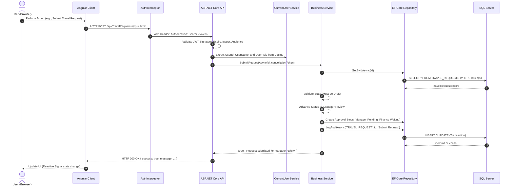
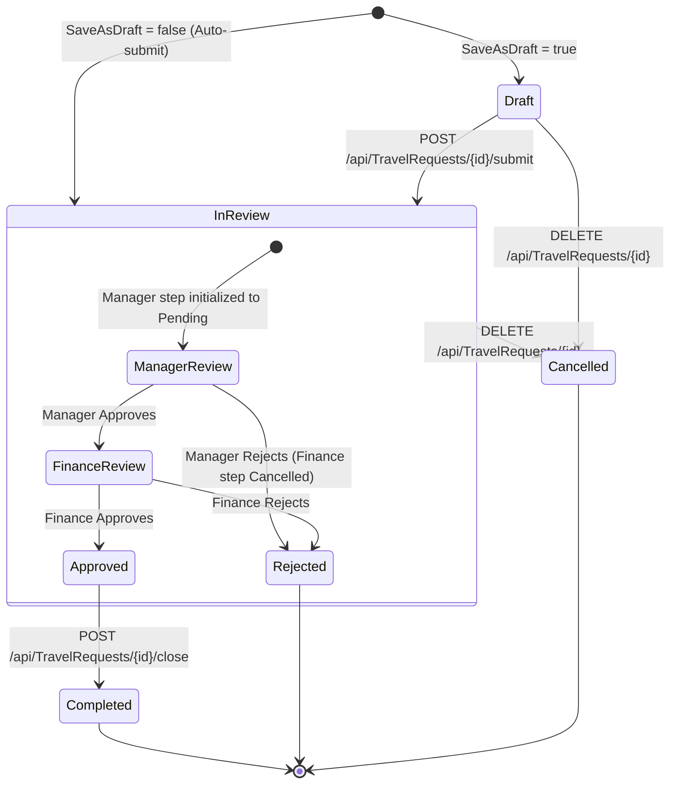

# VoyageHub Architecture Overview

This document describes the architectural layers, request lifecycle, authentication mechanisms, workflow state machines, audit logging patterns, and error handling implementations of VoyageHub.

---

## 1. System Layers & Organization

VoyageHub is structured as a 3-tier .NET 10 REST API backed by Microsoft SQL Server and an Angular 21 Single Page Application with Server-Side Rendering (SSR).

```mermaid
flowchart TD
    subgraph Frontend ["Client Tier (VoyageHub-Frontend)"]
        UI["Angular 21 Standalone Components"]
        Services["Angular HTTP Services (Signals & RxJS)"]
        Guards["RoleGuard (Route Protection)"]
        Interceptor["AuthInterceptor (Bearer Token Injection)"]
        SSR["Express 5 Server-Side Rendering Engine"]
    end

    subgraph ApiTier ["API Presentation Tier (VoyageHub.Api)"]
        Controllers["Controllers (REST Endpoints)"]
        JWT["JwtBearer Middleware"]
        CORS["CORS Policy (Environment-driven)"]
        CurrentUser["CurrentUserService (Claims Principal Extraction)"]
        Swagger["OpenAPI / Swagger Documentation"]
    end

    subgraph BusinessTier ["Core Business Tier (VoyageHub.Business)"]
        BizServices["Domain Workflow Services<br>(TravelRequest, Approval, Expense, Policy, Employee, Support, Analytics)"]
        AuditEngine["Audit Logging Engine (IAuditService)"]
        DTOs["Request & Response Data Transfer Objects"]
    end

    subgraph DataTier ["Data Access Tier (VoyageHub.Data)"]
        DbContext["AppDbContext (EF Core 10)"]
        Repositories["Custom & Generic Repositories<br>(ITravelRequestRepository, IExpenseRepository, etc.)"]
        Entities["Entity Data Models & Fluent API Mappings"]
    end

    Database[("Microsoft SQL Server / Azure SQL<br>(AngularAuthDb)")]

    UI --> Services
    Services --> Interceptor
    Interceptor -->|HTTP / JSON + Bearer Token| Controllers
    Controllers --> JWT
    JWT --> CurrentUser
    Controllers --> BizServices
    BizServices --> AuditEngine
    BizServices --> Repositories
    Repositories --> DbContext
    DbContext -->|T-SQL (TDS 1433)| Database
```

### Layer Responsibilities
1. **Presentation (`VoyageHub.Api`)**: Handles HTTP requests, enforces JWT Bearer authentication, extracts caller identity claims, performs model binding and file upload streaming, configures CORS, and serves OpenAPI specifications.
2. **Business Core (`VoyageHub.Business`)**: Implements travel request workflow routing, policy compliance validation, approval state transitions, reimbursement calculations, CSV batch upload stream parsing, and transactional audit event authoring.
3. **Data Access (`VoyageHub.Data`)**: Defines entity configurations, relationship constraints, indexes, cascading rules, and repository abstractions wrapping `AppDbContext`.
4. **Client Application (`VoyageHub-Frontend`)**: Angular 21 application utilizing standalone components, Angular Signals for reactive state management, role-based client guards (`RoleGuard`), and Express 5 for universal SSR.

---

## 2. End-to-End Request Flow



---

## 3. Authentication & Authorization Lifecycle

1. **Login Request**: User posts email and password to `/api/Auth/login`.
2. **BCrypt Verification**: `AuthService` queries `USERS` table by email and verifies the input password against the stored 60-character BCrypt hash (`BCrypt.Net.BCrypt.Verify`).
3. **JWT Generation**: On success, the API signs an HMAC-SHA256 JWT containing:
   - `sub`: User GUID
   - `email`: User email
   - `name`: User full name
   - `role`: Persona role (`Employee`, `Manager`, `Finance`, `Admin`)
   - `departmentId`: Department GUID
4. **Client Storage & Dispatch**: The Angular client stores the token in `localStorage` and injects it via `AuthInterceptor` on every outgoing HTTP request.
5. **Role-Based Enforcement**:
   - On the backend, endpoints enforce access using `[Authorize(Roles = "...")]`.
   - `CurrentUserService` supplies verified caller identity to business services, preventing callers from viewing or modifying requests belonging to other employees unless authorized by their role.

---

## 4. Travel Request Approval State Machine

The travel request lifecycle enforces a sequential multi-tier approval workflow implemented in `TravelRequestService.cs` and `ApprovalService.cs`:



### State Transition Invariants
1. **Draft $\rightarrow$ Manager Review**: Instantiates two sequential steps in `APPROVAL_STEPS`:
   - Step 1: `Level = "Manager"`, `Status = "Pending"`
   - Step 2: `Level = "Finance"`, `Status = "Waiting"`
2. **Manager Approval**: Advances step 1 to `"Approved"`. Updates request status to `"Finance Review"`. Advances step 2 to `"Pending"`.
3. **Finance Approval**: Advances step 2 to `"Approved"`. Updates request status to `"Approved"`.
4. **Any Rejection**: If either approver rejects, the corresponding step becomes `"Rejected"`, the request status becomes `"Rejected"`, and all remaining pending or waiting steps transition to `"Cancelled"`.
5. **Completion**: Once travel is finished, authorized personas can mark the request `"Completed"`.

---

## 5. Audit Logging Architecture

State-altering actions generate transactional audit records persisted to the `AUDIT_LOGS` table via `IAuditService.LogAsync()`:

- **Tracked Entities**: `TRAVEL_REQUEST`, `APPROVAL`, `EXPENSE`, `POLICY`, `EMPLOYEE`, `ACCESS`, `SUPPORT_TICKET`.
- **Recorded Metadata**:
  - `EntityId`: Unique identifier of the affected entity.
  - `Action`: Descriptive action verb (e.g., `"Submit Travel Request"`, `"Approve Step"`, `"Batch Payout"`).
  - `ActorId` & `ActorName`: Extracted from verified JWT caller claims.
  - `ChangeDetail`: Human-readable summary of fields changed or amounts approved.
  - `Severity`: Classified as `LOW`, `MEDIUM`, or `HIGH`.
  - `Timestamp`: UTC timestamp (`DateTime.UtcNow`).

---

## 6. Error Handling Strategy

1. **Startup Fail-Fast Validation**: In non-Development environments, `Program.cs` verifies database connectivity and validates that `Jwt:Key` contains at least 32 characters (256 bits). If configuration is invalid, execution terminates immediately with clear diagnostics.
2. **Business Result Pattern**: Service methods return strongly-typed value tuples (e.g. `(bool Success, string Message, T? Data)`) rather than throwing exceptions for predictable domain validation failures.
3. **Structured HTTP Status Codes**:
   - `400 Bad Request`: Validation errors, invalid date ranges, missing required files, or disallowed file extensions.
   - `401 Unauthorized`: Missing, invalid, or expired JWT Bearer token.
   - `403 Forbidden`: Authenticated user lacks the required role for the target endpoint.
   - `404 Not Found`: Target entity ID does not exist.
   - `500 Internal Server Error`: Unhandled exceptions logged via `ILogger<T>` with sensitive database connection details redacted.
