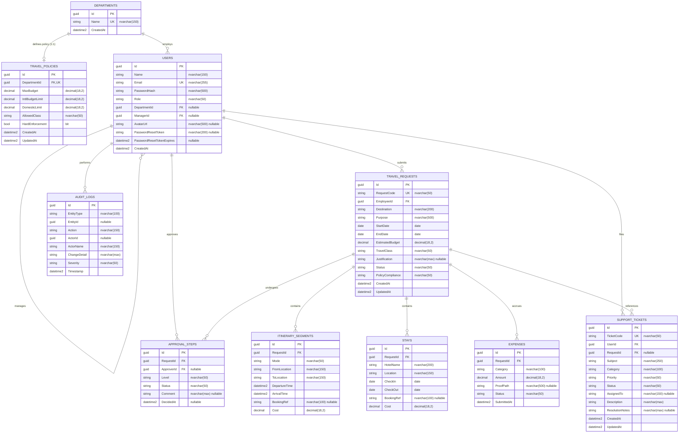

# VoyageHub Database Architecture & Schema Reference

This document provides the entity-relationship model, schema definitions, constraints, seeding mechanisms, and migration procedures for the VoyageHub database (`AngularAuthDb`).

---

## 1. Entity-Relationship Diagram



---

## 2. Table Catalog & Key Constraints

| Table Name | Primary Purpose | Foreign Keys & References | Unique Constraints | Cascade Delete Behavior |
| :--- | :--- | :--- | :--- | :--- |
| **`DEPARTMENTS`** | Organizational hierarchy units (Engineering, Product, Finance, etc.). | None | `UK_DEPARTMENTS_Name` | Restricts deletion if users or policies reference it. |
| **`USERS`** | System actors across all four persona roles. | `DepartmentId` $\rightarrow$ `DEPARTMENTS(Id)`, `ManagerId` $\rightarrow$ `USERS(Id)` | `UK_USERS_Email` | `ON DELETE SET NULL` on Department; `ON DELETE RESTRICT` on Manager. |
| **`TRAVEL_POLICIES`** | Budget caps, class rules, and enforcement flags per department. | `DepartmentId` $\rightarrow$ `DEPARTMENTS(Id)` | `UK_TRAVEL_POLICIES_Dept` (1:1) | `ON DELETE CASCADE` when parent department is deleted. |
| **`TRAVEL_REQUESTS`** | Core travel requisition lifecycle entity. | `EmployeeId` $\rightarrow$ `USERS(Id)` | `UK_TRAVEL_REQUESTS_Code` | `ON DELETE CASCADE` when parent user is deleted. |
| **`APPROVAL_STEPS`** | Sequential approval nodes (Manager & Finance) for travel requests. | `RequestId` $\rightarrow$ `TRAVEL_REQUESTS(Id)`, `ApproverId` $\rightarrow$ `USERS(Id)` | Composite index on `(RequestId, Level)` | `ON DELETE CASCADE` when parent request is deleted. |
| **`ITINERARY_SEGMENTS`** | Multi-modal travel legs (flight, train, taxi). | `RequestId` $\rightarrow$ `TRAVEL_REQUESTS(Id)` | None | `ON DELETE CASCADE` when parent request is deleted. |
| **`STAYS`** | Hotel and lodging reservations associated with a trip. | `RequestId` $\rightarrow$ `TRAVEL_REQUESTS(Id)` | None | `ON DELETE CASCADE` when parent request is deleted. |
| **`EXPENSES`** | Itemized out-of-pocket expenses and reimbursement claims. | `RequestId` $\rightarrow$ `TRAVEL_REQUESTS(Id)` | None | `ON DELETE CASCADE` when parent request is deleted. |
| **`SUPPORT_TICKETS`** | Internal corporate travel desk concierge inquiries. | `UserId` $\rightarrow$ `USERS(Id)`, `RequestId` $\rightarrow$ `TRAVEL_REQUESTS(Id)` | `UK_SUPPORT_TICKETS_Code` | `ON DELETE CASCADE` on User; `ON DELETE SET NULL` on Request. |
| **`AUDIT_LOGS`** | Append-only security and operational audit trail. | None (Loose actor attribution for historical durability) | None | Non-cascading append-only records. |

---

## 3. Seed Data Mechanics

The schema script automatically provisions standard corporate foundation data:
1. **Departments**: Engineering, Product Management, Finance & Accounts, Sales & Operations, Human Resources, Administration.
2. **Travel Policies**: Standard baseline limits (e.g., Engineering: ₹80,000 domestic, ₹2,50,000 international; Economy class only; hard enforcement enabled).
3. **Demo Personas**:
   - `admin@voyagehub.in` (System Admin)
   - `priya.nair@voyagehub.in` (Manager)
   - `vikram.mehta@voyagehub.in` (Finance Officer)
   - `aarav.patel@voyagehub.in` (Employee)

---

## 4. Difference: Local vs. Azure SQL Schema Scripts

VoyageHub maintains two schema scripts with distinct cloud-safety characteristics:

| Dimension | `database/VoyageHub_Schema.sql` (Local Development) | `database/VoyageHub_Schema.azure.sql` (Hosted / Azure SQL) |
| :--- | :--- | :--- |
| **Database Creation** | Includes `CREATE DATABASE [AngularAuthDb]` and `USE [AngularAuthDb]` statements. | Omits database creation and `USE` statements (unsupported in Azure SQL managed pools). |
| **Seeded User Passwords** | Seeds active BCrypt password hashes (`VoyageHub@2026`) for immediate offline development. | Seeds disabled placeholder `'DISABLED-SET-VIA-DEPLOYMENT-MD'` to prevent accidental default credentials in cloud environments. |
| **Usage Context** | Local SQL Server Express instances or Docker SQL Server containers. | Azure SQL Database (Free Offer) or hosted production databases. |

---

## 5. How to Reset the Database

To reset the database back to clean baseline seed data:

### Automated Reset via PowerShell
```powershell
.\database\run_migration.ps1 -Server ".\SQLEXPRESS06" -Database "AngularAuthDb"
```

### Manual Reset via SQL Server Command Line (`sqlcmd`)
```powershell
sqlcmd -S ".\SQLEXPRESS06" -d master -E -i "database\VoyageHub_Schema.sql"
```
*(This script drops and recreates tables if they exist, resetting all test travel requests, approval queues, and expense records to default state.)*
